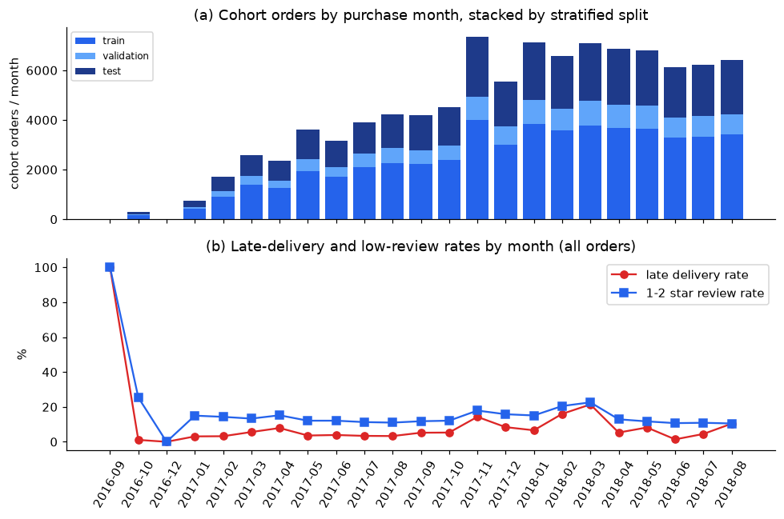

# Low-Review Classification · Current Review Entry Point

**Protocol change: 2026-10-09; leakage fixes: 2026-10-10 (dry run, `QUICK = True`).** The package now uses the split design of
Zaghloul, Barakat & Rezk (2024, *J. Retailing and Consumer Services* 79:103865) — the published study on
the same Olist target — with a validation set added: stratified 67/33 train+validation / test on
`is_low_review`, then stratified 80/20 train / validation (overall 53.6 / 13.4 / 33.0, seed 5006).
The chronological, label-matured protocol of the regression package is kept as a switch
(`clf_config.SPLIT_SCHEME = "chronological"`) and its last results are summarised at the end as a
robustness reference. Latest entry points:
[baseline_variant_review.ipynb](../notebooks/baseline_variant_review.ipynb) (family ladder, Table 7) and
[ensemble_comparison.ipynb](../notebooks/ensemble_comparison.ipynb) (Family C, class-balance study).
Ensemble methods and findings: [ensemble_comparison.md](ensemble_comparison.md); imbalance strategies
(none / weights / RandomOverSampler / SMOTE / ADASYN) and SHAP: [sampling_comparison.md](sampling_comparison.md).

All numbers below come from the committed dry run (4 random-search draws per family, 100-tree forests,
≤ 200-iteration CatBoost). They validate the code path; the report numbers must come from a
`QUICK = False` run (see "Reproduce").

## Problem and experiment boundary

Predict, for each order, whether its review will be 1-2 stars (`is_low_review`), one row per order. The
prediction point is **T = min(delivered date, estimated delivery date)**: Olist sends the review survey at
delivery or at the promised date if the parcel has not arrived, so T is the last moment an intervention
can precede the rating. Inputs are restricted to what is known at T: order composition, prices and
freight, product dimensions, customer/seller geography (audited zip-prefix coordinates and maximum
item-route distance from `../Regression/historical_temporal/src/data_preparation_audit.py`), the promise length, point-in-time seller
and route history, and the delivery status as of T. Review text, review timing, actual delivery after T
and anything dated after T are excluded (`config/feature_roles.csv`, role `post_outcome`). Full
specification in [`config/problem_spec.json`](../config/problem_spec.json).

**Features from the literature.** The five engineered features of Zaghloul et al. (§3.4) are included in
prediction-point-safe form: `total_order_value` (price + freight), `payment_total`, `freight_ratio`, and
the two working-day delivery features `wd_actual_delivery_time` and `wd_delivery_time_delta` (Mon–Fri,
Brazilian national holidays excluded, evaluated as of T so they are NaN for the 10% of orders not yet
delivered when the survey is triggered). Their sixth top feature, `review_comment_message`, is part of the
review itself and is not used. 52 features in total.

**Cohort and split.** 97,490 reviewed orders with at least one line item, purchased 2016-09 to 2018-08, whose review was answered after the prediction point T (426 orders answered before T are excluded).

| Split | Orders | Share | Positives | Positive rate | Delivered by T |
|---|---:|---:|---:|---:|---:|
| train | 52,254 | 53.6% | 7,394 | 14.15% | 90.1% |
| validation | 13,064 | 13.4% | 1,849 | 14.15% | 90.4% |
| test | 32,172 | 33.0% | 4,553 | 14.15% | 90.1% |

The split is uniform in time (every purchase month is ≈ 33% test / 13% validation) and is written to
`data/split_manifest.csv`; `scripts/verify_classification.py` rebuilds it from the seed and checks it
matches. Roles, fixed before fitting: **train** — pipelines and `StratifiedKFold(5, shuffle=True)` for
hyper-parameters and out-of-fold probabilities (seller / route history refitted inside every fold); **validation** — baselines vs ladder, CatBoost early
stopping, F1 threshold, stacking / ensemble retention rule; **test** — scored once per final model.

**Leakage control under a random split - three guards.**

1. *Fold-level history.* Seller / route history (delivery days, late rate, low-review rate,
   route statistics, `seller_id_enc`) is a transformer, `clf_features.HistoryInPipeline`, placed as
   the **first step of every modelling pipeline**. It stores the outcome events of the rows it is
   fitted on and attaches, to each row it transforms, the smoothed statistics of stored events known
   strictly before that row's purchase (`merge_asof`, `allow_exact_matches=False`). Because it is a
   pipeline step, `RandomizedSearchCV`, the sklearn stacker, the OOF loop and the sampling grid
   refit it on each fold's fit rows, so a CV-held-out order's outcome never reaches any feature the
   fold's model is trained on. The stored feature table uses the same transformer fitted on the
   training split (for the audit and the single-feature table). The key / timestamp / outcome
   columns the step needs travel inside `X` and are dropped by the step before the preprocessor;
   `assert_history_context_dropped` checks this in the ladder notebook and the verifier.
2. *Review labels exist when answered, not when the survey is sent.* `review_creation_date` is the
   date Olist sent the survey; `review_answer_timestamp` (never missing, median 1.7 days later) is
   when the customer submitted the score. Review history and the chronological maturity rule now use
   `review_answer_timestamp` (`LABEL_KNOWN_COLUMN`). The audit rebuilds the smoothed seller
   low-review rate from reviews answered before each sampled order's purchase and matches exactly.
3. *No label before the prediction point.* 426 orders (0.44%) had their review answered before
   T = min(delivered, estimated); their label existed at the prediction point, so they are excluded
   from the cohort (`_eligible_p2`). The earlier "3.1% of reviews before T" used the survey-sent
   date and is now reported only as informational ("surveys sent before T").

Structural assert on feature roles, delivery-as-of-T consistency and single-feature AUC also pass.

**Test-set discipline.** Every table scores the test set once per row so the reader can see it,
but no decision uses a test number: the final single model, the stacking / ensemble retention and
the imbalance strategy are all chosen on validation PR-AUC, and `verify_classification.py`
re-derives each of those choices from the published tables and fails if a test column would have
chosen differently.

## Current results (dry run)

| Model / rule | 5-fold CV PR-AUC | Validation PR-AUC | Test PR-AUC | Test ROC-AUC | Test P / R @ thr | Test Brier |
|---|---:|---:|---:|---:|---|---:|
| Majority class (nobody complains) | — | 0.142 | 0.142 | 0.500 | — | 0.121 |
| Rule: flag if not delivered by T | — | 0.326 | 0.326 | 0.682 | 0.59 / 0.41 | 0.124 |
| A · logistic, default C | — | 0.468 | 0.490 | 0.786 | 0.54 / 0.50 | 0.166 |
| A · logistic, C searched (C = 100) | 0.498 ± 0.013 | 0.468 | 0.489 | 0.786 | 0.54 / 0.50 | 0.166 |
| B · decision tree (depth 12, leaf 179) | 0.487 ± 0.010 | 0.466 | 0.483 | 0.769 | 0.55 / 0.47 | 0.171 |
| **B · random forest** (depth 17, leaf 89, max_features 0.49) | 0.513 ± 0.011 | **0.489** | **0.503** | 0.786 | 0.52 / 0.51 | 0.149 |
| B · CatBoost (depth 6, early-stopped at 245 it.) | 0.504 ± 0.014 | 0.482 | 0.497 | 0.787 | 0.51 / 0.53 | 0.159 |
| C · sklearn stacking of A/B (not retained) | — | 0.487 | 0.506 | 0.788 | 0.55 / 0.49 | 0.093 |

Source: [`outputs/tables/model_comparison.csv`](../outputs/tables/model_comparison.csv). CV, validation
and test agree within about two CV standard deviations for every model. The random forest is the
final single model (validation maximiser); at its frozen threshold 0.63 it flags 13.6% of test
orders with precision 0.52 (3.7× the 14.2% base rate) and recall 0.51; the top-10% list captures
43% of all complaints. Stacking (0.487) does not reach the 1% relative validation gain required for
retention. Compared with the pre-fix run (validation 0.515 / test 0.508) the validation score fell by
0.026 and the test score by 0.005: the fold-level history fix removes the optimism that leaked into
CV / validation through shared seller statistics, while the honest test estimate barely moves.

Permutation importance on validation: `is_delivered` (0.043), `n_items` (0.035), then the two
literature features `wd_delivery_time_delta` (0.015) and `wd_actual_delivery_time` (0.013),
`carrier_transit_days` (0.013), `delivery_time_delta` (0.011). Removing the whole delivery block
drops the forest's validation PR-AUC from 0.489 to 0.297. SHAP on the final forest
([sampling_comparison.md](sampling_comparison.md)) ranks `is_delivered`, `n_items`, `seller_id_enc`,
`wd_actual_delivery_time`, `actual_delivery_time` top five; CatBoost SHAP agrees at Spearman 0.85.



## Areas that need attention

1. **What the random split measures.** Validation and test share the training rows' month mix, so the
   scores estimate performance on the 2016-18 order mix, not on a future month. The March 2018 postal
   disruption (21% late, 23% low reviews) is diluted into every partition. State this in the report and
   quote the chronological reference below as the drift cost.
2. **History features are stricter than production.** Only training-row outcomes feed them, so a seller's
   prior late rate is estimated from ~54% of their history. In deployment all past outcomes would be
   available; the features would be slightly stronger, not weaker.
3. **No imbalance strategy improves ranking.** The 4 × 5 grid in
   [sampling_comparison.md](sampling_comparison.md) (none / class weights / RandomOverSampler / SMOTE /
   ADASYN) shows `none` and `class_weight` tied within 0.001 validation PR-AUC for every model (the
   forest: 0.489 both), weighting and random oversampling coinciding and raising the Brier score
   (0.092 → 0.149 for the forest), SMOTE / ADASYN costing 1–3 PR-AUC points. Report the unweighted
   forest as the final scorer with the validation-frozen threshold, and quote the grid as the
   class-imbalance discussion the brief asks for.
4. **Ensembles are within noise of the forest** (test 0.504–0.506 vs 0.503; validation 0.485–0.488 vs
   0.489) because the three base models' OOF probabilities are highly correlated. Not retained under
   the 1% rule; the logistic stack is nevertheless the best-calibrated scorer (Brier 0.092).
5. **Run the full search before quoting numbers.** `QUICK = True` uses 4 draws and 100-tree forests;
   CatBoost in particular is under-searched (200 iterations in the grid). Expect 1–2 h for
   `baseline_variant_review` with `QUICK = False`; `sampling_comparison` adds 20 fits and the SHAP sample.
6. **Hash verification.** Any edit to `src/clf_*.py` or the scripts changes a source digest; rerun
   `scripts/reproduce_classification.py` (or `--protocol-only` after `run_notebook.py`) to refresh
   `outputs/experiment_protocol.json`.

## Chronological reference (previous protocol, dry run of 2026-10-07)

With `SPLIT_SCHEME = "chronological"` (regression package windows: train = purchased and reviewed before
2018-03-01, validation = March 2018, April–June maturation gap, test = July–August 2018; 49 features, no
working-day features, history not yet fold-fitted) the same ladder gave random forest validation PR-AUC 0.642 on March (positive rate
22.6%) and **test PR-AUC 0.360** on July–August (positive rate 10.7%, majority baseline 0.107); logistic
0.349, CatBoost 0.357, ensembles 0.364–0.368. The gap to the stratified 0.503 is prevalence shift plus
drift, not model quality: PR-AUC scales with the positive rate (baseline 0.107 vs 0.142) and the test
months were the calmest in the data. Re-run with the switch to refresh this reference once the final
configuration is fixed; it belongs in the report's Limitations.

## Reproduce

From the group repository root, `cd "Phase 2/Classification"`. Course CSVs are found via
`OLIST_CSV_DIR`, the repository's `notebooks/data/`, or the course ZIP via `OLIST_ARCHIVE`
(same archive as the regression package, SHA256
`90ee50730a9e799aa2d3c7b1758fef680cbbc366f61a287870144796a37156d4`).

```bash
python -m pip install -r ../Regression/historical_temporal/requirements.txt -r requirements.txt
python scripts/run_notebook.py notebooks/data_preparation_audit.ipynb      # 1 min; writes data/split_manifest.csv
python scripts/run_notebook.py notebooks/baseline_variant_review.ipynb     # set QUICK = False in cell 1
python scripts/run_notebook.py notebooks/ensemble_comparison.ipynb
python scripts/run_notebook.py notebooks/sampling_comparison.ipynb     # 20 fits + SHAP
python scripts/reproduce_classification.py --protocol-only                 # digests -> outputs/experiment_protocol.json
python scripts/verify_classification.py                                    # 46 checks incl. split manifest, fold-fitted history, answer timestamps
python -m unittest discover -s tests -v                                    # 13 tests, synthetic data, seconds
```

Git-ignored and regenerated locally: `data/` (feature table, split manifest), `models/`,
`outputs/predictions/`, `outputs/oof/`.
