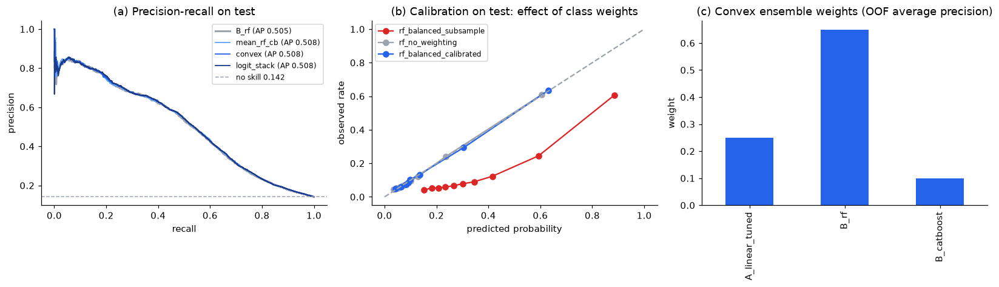

# Logistic + Random Forest + CatBoost: Averaging, Convex Weights and Logistic Stacking

Updated: 2026-10-10 (stratified split, fold-fitted history, dry run `QUICK = True`)

The [executed Notebook](../notebooks/ensemble_comparison.ipynb) is the single entry point for the
Family C comparison. It mirrors the regression package's
[ensemble_comparison.ipynb](../../../Regression%20Work/historical_temporal/notebooks/ensemble_comparison.ipynb): base models are refitted per
fold to produce out-of-fold (OOF) probabilities, the combiners are fitted on those OOF rows only,
selection happens on the validation set, and the test set is scored once per method with an
independent PR-AUC implementation as a cross-check.

## Base models and OOF construction

Base models are the three tuned configurations retained in
[baseline_variant_review.ipynb](../notebooks/baseline_variant_review.ipynb): `A_linear_tuned`
(logistic regression, C = 100, class-weighted), `B_rf` (random forest, depth 17, min leaf 89,
max features 0.49, `balanced_subsample`) and `B_catboost` (depth 6, learning rate 0.076,
early-stopped at 245 iterations). Each is refitted on the five stratified shuffled folds of the
training rows (`split.cv_folds`, seed 5006) — including its first step, the seller / route history,
so a held-out fold's outcomes are absent from every feature the base model was trained on — and
**every one of the 52,254 training orders** gets exactly one OOF probability from a model that never
saw it. OOF positive rate 14.2%.

## The combiners

| Method | Definition | Learnt on OOF |
|---|---|---|
| `mean_three` | arithmetic mean of the three probabilities | nothing |
| `mean_rf_cb` | mean of the two tree models | nothing |
| `convex` | `w · p` with `w ≥ 0, Σw = 1`, chosen on a 0.05 simplex grid to maximise OOF average precision | 3 weights |
| `logit_stack` | logistic regression on the three logits, class-weighted | 3 coefficients + intercept |

Weights are found by grid search on average precision rather than by minimising log-loss: log-loss
collapses the weights onto the best-calibrated model because the three base models are calibrated
differently, whereas the ranking metric is what the stakeholder uses. Dry-run convex weights:
0.30 logistic / 0.70 forest / 0.00 CatBoost; logistic-stack coefficients 0.28 / 0.71 / −0.01. CatBoost
adds nothing once the forest is in — the OOF probabilities of the three models are highly correlated.
Both weight sets are re-learnt whenever the base models change.

## Comparison on the same rows

| Method | Validation PR-AUC (selection) | Test PR-AUC | Test ROC-AUC | Test precision / recall @ thr | Test Brier |
|---|---:|---:|---:|---|---:|
| `A_linear_tuned` | 0.468 | 0.489 | 0.786 | 0.54 / 0.50 | 0.166 |
| `B_rf` (final single model) | **0.489** | 0.503 | 0.786 | 0.52 / 0.51 | 0.149 |
| `B_catboost` | 0.479 | 0.493 | 0.785 | 0.52 / 0.51 | 0.164 |
| `mean_three` | 0.485 | 0.504 | **0.789** | 0.54 / 0.50 | 0.158 |
| `mean_rf_cb` | 0.488 | 0.505 | 0.787 | 0.51 / 0.52 | 0.155 |
| `convex` | 0.487 | **0.506** | 0.788 | 0.55 / 0.50 | 0.153 |
| `logit_stack` | 0.487 | **0.506** | 0.788 | 0.55 / 0.50 | **0.092** |

Source: [`outputs/tables/ensemble_test_results.csv`](../outputs/tables/ensemble_test_results.csv),
[`ensemble_weights.csv`](../outputs/tables/ensemble_weights.csv); thresholds in
[`outputs/ensemble_summary.json`](../outputs/ensemble_summary.json).

**Decision: no ensemble retained; the final model stays `B_rf`.** The retention rule, fixed before
scoring (`config/problem_spec.json`), requires a ≥ 1% relative gain in validation PR-AUC over the best
single model; the best combiner (`mean_rf_cb`, 0.488) is 0.2% *below* the forest. On test the picture is
the same within noise (0.504–0.506 vs 0.503; the bootstrap standard error of PR-AUC on 32k test rows
with 4.6k positives is about 0.008). The one real difference is calibration: the logistic stack's
intercept re-centres the probabilities and reaches Brier 0.092 against 0.149 for the class-weighted
forest, so if the risk score is to be shown as a probability rather than used as a ranking, the
logistic stack (or the unweighted forest, see below) is the better scorer at no ranking cost.

Why the gain is small by construction: all three base models rank the same orders similarly because
the signal is dominated by one feature block (delivery as of T); averaging reduces variance but cannot
add information the forest does not already use.



## Class-balance study

Same notebook, Section 7; the question is whether class weighting does anything a threshold could not.
Four forest variants with the retained hyper-parameters:

| Variant | Validation PR-AUC | Test PR-AUC | Test Brier | Flag rate @ 0.5 | Recall @ 0.5 | Recall @ tuned thr. |
|---|---:|---:|---:|---:|---:|---:|
| no weighting | **0.489** | **0.504** | **0.092** | 8.0% | 0.37 | 0.52 |
| `balanced_subsample` (ladder) | 0.489 | 0.503 | 0.149 | 19.6% | 0.60 | 0.51 |
| SMOTE inside the pipeline | 0.475 | 0.497 | 0.099 | 10.7% | 0.44 | 0.50 |
| `balanced_subsample` + isotonic on validation | 0.482 | 0.488 | 0.093 | 7.6% | 0.35 | 0.51 |

Source: [`outputs/tables/class_balance_study.csv`](../outputs/tables/class_balance_study.csv).

Ranking quality is unchanged by weighting (test PR-AUC 0.504 vs 0.503) and recall at the
validation-tuned threshold is the same (0.52 vs 0.51); what changes is the probability scale, so the
Brier score worsens and the default-cut flag rate rises from 8.0% to 19.6%. Weighting therefore acts
as a built-in threshold shift. SMOTE costs ranking (0.497) for a smaller Brier gain; isotonic
calibration fitted on validation repairs the scale but costs ranking on test (0.488). The full
4 models × 5 strategies grid, including RandomOverSampler and ADASYN, is in
[sampling_comparison.md](sampling_comparison.md) and reaches the same conclusion for every model.
Recommendation for the report: use the unweighted forest with the validation-frozen threshold (same
ranking, honest probabilities), state that class imbalance on this target affects calibration rather
than ranking, and report Brier next to PR-AUC.

## Evidence limitations

- Validation and test are stratified random samples of the same 2016-18 order population as the
  training rows; they do not measure performance on a future month. The chronological reference in
  [current_progress.md](current_progress.md) (July–August 2018 hold-out, PR-AUC 0.36 under the old
  protocol with a 10.7% positive rate) is the drift-aware number and belongs in Limitations.
- History features are refitted per fold from the fold's fit rows (review labels dated by
  `review_answer_timestamp`); in production all past outcomes would be available.
- The retention rule uses one 13% validation slice; the OOF rows (all 52k training orders) are a
  larger selection set. If the team prefers "better on OOF *and* not worse on validation", decide
  that before reading the full-run test numbers and record it here.
- The test set was scored once per method here, so **these test numbers are the only test scores for
  this package**; a `QUICK = False` rerun replaces them in full and must not be followed by any
  further selection.

## Reproduce

```bash
cd "Phase 2/Classification"
python scripts/run_notebook.py notebooks/baseline_variant_review.ipynb   # produces selected_models.json
python scripts/run_notebook.py notebooks/ensemble_comparison.ipynb       # ~10 min QUICK, ~40 min full
python scripts/reproduce_classification.py --protocol-only
python scripts/verify_classification.py
```

`ensemble_comparison.ipynb` reads `outputs/selected_models.json` and the feature table in `data/`;
run `data_preparation_audit.ipynb` and `baseline_variant_review.ipynb` first. OOF probabilities are
saved to `outputs/oof/base_oof_probabilities.csv` (git-ignored) for inspection.
