# Low-review risk classification (Phase 3)

This is the only document for the classification branch. It explains what the code does, step by step, and what every run found. Every number comes from a file in `outputs/classification/`.
- **Part A** is the v1 model: the chronological protocol and the frozen headline result.
- **Part B** covers the experiments run on top of v1: leakage audit, class balancing, features, training windows, tuning and a comparison of all models.

---

## 0. Summary and how to use this folder

**Results**
- **Headline model (v1):** a random forest.
  - Test PR-AUC **0.375** on Jun–Aug 2018 (3.3 × the no-skill rate of 0.113).
  - The riskiest 20% of orders contain **53.2%** of low reviews.
  - Both success criteria set before testing are met.
- **All models.** Logistic regression, a decision tree, a random forest, histogram gradient boosting (HGB) and CatBoost.
  - Every model was given the same features, protocol and test window.
  - Every one meets both criteria: test PR-AUC 0.347–0.375, recall in the top 20% 0.532–0.537.
  - The ensembles (forest, HGB, CatBoost) lead logistic regression by about 0.005 and the single tree by about 0.03.
- **Experiments.** Five new feature groups, two training windows, a 21-candidate forest search and a 30-candidate HGB search.
  - None improved validation PR-AUC by the agreed +0.010.
  - Removing class weights kept the ranking and turned the scores into calibrated probabilities (Brier 0.157 → 0.100).
- **Class balancing** (§8). No correction is best for four of five families. Random undersampling, random oversampling and SMOTE all lower PR-AUC, by 0.002–0.022.
- **Stacking** (§9.6). One convex stack of logistic regression, the forest and HGB, built like the regression team's stack. Validation +0.0007 PR-AUC (3/5 months), so it is not retained. On test it is +0.0035 better (secondary evaluation, too small to change the decision).
- **Strict cut-off rerun** (§9.7). The v1 selection rerun so that every training label, validation label and feature was available at its cut-off (the [quality audit](quality_audit.md) findings). The forest is still chosen; validation PR-AUC moves by about −0.002 and test PR-AUC is 0.374 (Δ −0.001 against v1, CI includes zero). v1 stays the headline.

**Do you need to run the code? No.** Every result is already saved:

| What | Where |
|---|---|
| v1 tables, figures, selection, test lock | `outputs/classification/` (tables/, figures/, selection.json, test_lock.json) |
| Experiment tables, figures, run log | `outputs/classification/experiments/` (tables/, figures/, run_log.txt) |
| Strict cut-off rerun (§9.7) | `outputs/classification/strict_cutoff/` (tables/, figures/, selection_strict.json, test_lock_strict.json, run_log.txt) |
| Executed notebooks (read saved outputs, train nothing) | `notebooks/classification_chronological.ipynb` (v1), `notebooks/classification_experiments.ipynb` (experiments) |

Open the notebooks, or read this document. Run the code only to reproduce the results, or after changing it.

**How a run works.** There are three command-line runners. Both are deterministic (seed 5006) and both pass results only through files.

| Command (from `Phase_3/`) | What it does | Time on 8 cores |
|---|---|---|
| `python src/classification/run_pipeline.py` | **Part A.** Stages `prepare`, `select`, `test`, `reference`, `figures`. Builds the feature table, tunes every family on 5 folds, freezes the selection, scores the test window once, then runs the random-split reference | about 2.5 h |
| `python src/classification/run_experiments.py` | **Part B.** Steps S0–S10, then the class-balancing study (CB), then stacking (ST). Each step reads the v1 outputs | about 2.4 h for S0–S10 from scratch, plus about 1 h for CB and 16 min for ST |
| `... run_experiments.py --class-balance` | Only the class-balancing study | about 1 h |
| `... run_experiments.py --stacking` | Only the stacking comparison | 16 min (22 s from the cache) |
| `... run_experiments.py --figures` | Redraws figures E01–E12 from the saved tables | 5 s |
| `python src/classification/run_strict_cutoff.py` | **Strict cut-off rerun** (§9.7). Steps `data`, `diagnostic`, `select`, `test`, `figure` (`--step` runs one). Reads the v1 outputs, writes only to `strict_cutoff/` | about 2.2 h (minutes from the cache) |
| `python -m unittest discover -s tests -v` | 21 classification protocol and leakage tests (plus the other teams' tests) | about 2 min |

Every run uses the full data and the full search budgets. There is no reduced or smoke-test mode, so every saved number comes from a full run.

- **Caching and resuming.** Every (configuration, fold) result and every final fit is cached as a file in `outputs/classification/experiments/runs/`. An interrupted or repeated run computes only what is missing. Rerunning `run_experiments.py` today finishes in minutes and reproduces every number.
- **Test lock.** The test window is protected by a lock file. Rerunning with the same frozen selection is allowed and logged. Scoring it with a different selection is refused.

---

# Part A — the v1 model and protocol

## 1. Problem

| | |
|---|---|
| Stakeholder and decision | Olist's customer-experience (CX) team contacts the 20% highest-risk orders each day, before the customer answers the review survey |
| Prediction point | **T = min(delivered date, estimated delivery date)**: the survey trigger. Every feature must be known at T |
| Target | `is_low_review` = 1 if the review score is 1 or 2 (about 15% of orders) |
| Primary metric | PR-AUC (average precision): the target is imbalanced and the task is ranking |
| Supporting metrics | recall and precision in the top 20% (the operating rule), ROC-AUC, Brier score (probability quality), training − validation gap |
| Success criteria (fixed 28 Oct 2026, before any chronological result) | test PR-AUC ≥ 2 × the test positive rate; the top 20% contains ≥ 50% of the low reviews |

## 2. Data and cohort

The nine Olist course CSVs are joined into one row per order (`data.py`, `features.py`). The SHA-256 hash of each source file is recorded in `source_inventory.csv`.

| Cohort step (`cohort_flow.csv`) | Orders | Removed |
|---|---|---|
| All orders | 99,441 | |
| At least one line item | 98,666 | 775 |
| Has a review | 97,917 | 749 |
| Review answered after T (otherwise the label is known at T) | 97,490 | 427 |
| T in Jan 2017 – Aug 2018 (2016 has only 303 orders, too few to train on) | **97,187** | 303 |

**Censoring check.** Reviews are not missing at the end of the extract: the share of orders with no review is 0.43–0.64% in Jun–Aug 2018, against 0.6–1.0% earlier (`censoring_by_t_month.csv`).

## 3. Features

**v1 has 51 features in 9 groups.** They are the Phase 2 set minus `black_friday_week`, which flags only 20–30 Nov 2017 and is 0 in every validation and test month.

| Group | Features | Computed |
|---|---|---|
| order (7) | items, distinct products, sellers, price, freight, freight ratio, order value | stored |
| product (6) | total / max weight, volume, max dimension, main category, number of categories | stored |
| geography (9) | seller–customer distance, distance missing, same state / city, states, regions, customer 2-digit zip | stored |
| calendar (4) | purchase month, weekday, hour, weekend | stored |
| promise (3) | promised days, days to the shipping limit, approval lag | stored |
| payment (4) | main payment type, maximum instalments, number of methods, total paid | stored |
| delivery at T (9) | delivered by T, delivery time, delivery vs promise, carrier shipped, handover days, transit days, delivery vs the seller's past average, working-day versions | stored; every timestamp is capped at T |
| seller history (6) | seller's past orders, tenure, past mean delivery days, past late rate, past low-review rate, target-encoded seller id | **inside the pipeline, per fold** |
| route history (3) | past orders, mean delivery days and late rate on the seller-state → customer-state route | **inside the pipeline, per fold** |

The stored table (`data/classification/orders_features.parquet`) contains **no outcome-based column**. Every feature that uses other orders' outcomes is computed inside the model pipeline from the training rows of the current fold (§5).

## 4. Train, validation and test split

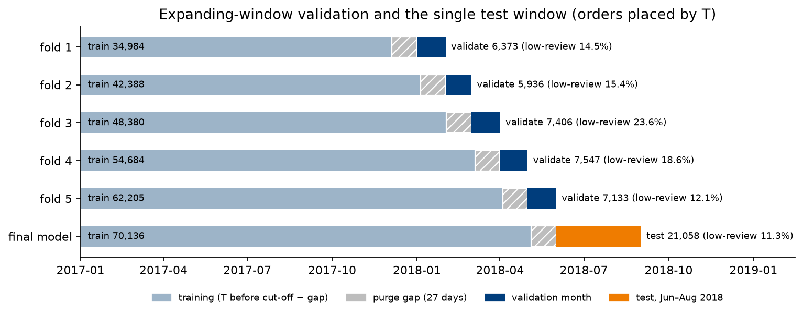

1. **Time axis.** Every order sits at its prediction point T.
2. **Validation: five expanding-window folds.** Fold k validates on one calendar month of T and trains on every order with T from Jan 2017 up to the fold's cut-off minus the purge gap.
3. **Purge gap k = 27 days.**
   - A training order needs T at least 27 days before the cut-off.
   - Its review is normally answered within days of T. Without the gap, some training labels would be answered after the cut-off, so a model "trained on that day" would see the future.
   - 27 days is the 99th percentile of (review answered − T), measured on 2017 orders and rounded up (`purge_gap.json`).
   - The gap filters rows by T only. It reduces exposure to reviews answered after the cut-off but does not remove it: 0.12–0.24% of training labels still fall after the cut-off, and the splitter has no explicit review-answer condition (see §13 and the [quality audit](quality_audit.md)).
4. **Test window.** Jun–Aug 2018. The final model trains on every order with T before 1 Jun 2018 minus the gap.

| Fold | Training: T from Jan 2017 up to | Training rows | Training positive rate | Validation month | Validation rows | Validation positive rate |
|---|---|---|---|---|---|---|
| 1 | 4 Dec 2017 | 34,984 | 12.1% | Jan 2018 | 6,373 | 14.6% |
| 2 | 4 Jan 2018 | 42,388 | 13.3% | Feb 2018 | 5,936 | 15.4% |
| 3 | 1 Feb 2018 | 48,380 | 13.4% | Mar 2018 | 7,406 | 23.6% |
| 4 | 4 Mar 2018 | 54,684 | 13.6% | Apr 2018 | 7,547 | 18.6% |
| 5 | 3 Apr 2018 | 62,205 | 14.9% | May 2018 | 7,133 | 12.1% |
| Final | 4 May 2018 | 70,136 | 15.1% | **Test Jun–Aug 2018** | 21,058 | 11.3% |

- **Why monthly PR-AUC moves so much.** The positive rate runs from 12% to 24%. Mar 2018 had a delivery disruption: only 76.7% of orders were delivered by T. PR-AUC rises with prevalence, so every comparison is **paired by month** ("better in at least 4 of 5 months"), not only by mean.
- **Why the test window scores lower.** It has the lowest positive rate (11.3%) and fewer late orders.
- **Test lock.** `prepare` hashes the test-window order ids before any model exists (`test_lock.json`).
  - `test` refuses to run without a frozen `selection.json`, and refuses a different selection after the first evaluation.
  - v1 was evaluated once.

## 5. Processing pipeline (fitted on each fold's training rows only)

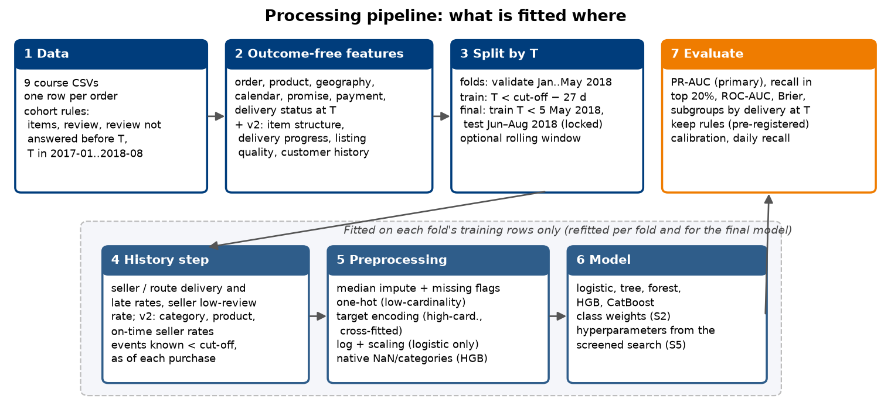

Every model is a scikit-learn `Pipeline` of three steps. It is refitted for every fold and for the final model.

1. **History step** (`features.HistoryInPipeline`; extended in Part B by `experiment_features.HistoryV2`).
   - Stores the delivery and review events of the training rows whose outcome was known before the fold's cut-off (`event_cutoff`).
   - Each order receives the seller and route statistics as of its own purchase time.
   - Rates are smoothed toward the training mean: (events × rate + 20 × mean) / (events + 20).
2. **Preprocessing** (`models.make_preprocessor`; one per model kind):

   | Kind | Numeric | Low-cardinality categoricals (states, regions, payment type) | High-cardinality (category, seller id, zip2) |
   |---|---|---|---|
   | linear (logistic) | median imputation + missing flags, log1p of skewed amounts and counts, standardisation | one-hot (levels under 20 rows pooled) | cross-fitted target encoding |
   | tree (decision tree, forest) | median imputation + missing flags | one-hot | cross-fitted target encoding |
   | hgb | passed through (HGB handles missing values natively) | ordinal codes → HGB's native categorical splits | cross-fitted target encoding |
   | catboost | passed through | strings → CatBoost's ordered target statistics | strings → ordered target statistics |

3. **Classifier**, with its class-imbalance treatment (§8) and hyperparameters (§7).

Validation and test rows only ever pass through `transform` / `predict_proba`. No imputer, encoder, history table or resampler is fitted on them.

## 6. Leakage controls

| Risk | Control | Evidence |
|---|---|---|
| Labels from the future | 27-day purge gap | 0.12–0.24% of training labels remain after the cut-off (`fold_table.csv`). Removing them changes PR-AUC by −0.0003 (S1b) |
| Outcome-based features | Seller and route history computed inside the pipeline, frozen at the fold's cut-off, attached as of purchase time | Unit tests flip every post-cut-off label and check the features do not change; brute-force recounts |
| An order seeing its own label | History uses strictly earlier events | Unit test: changing a scored order's outcome leaves its features unchanged |
| Information after T in delivery features | Every timestamp is capped at T | `assert_v2_no_leakage` |
| Preprocessing fitted on validation | All encoders inside the pipeline; target encoding is cross-fitted | Pipeline design |
| Test window used for decisions | Hash lock; selection frozen before scoring; interpretation on May 2018, not on test | `test_lock.json`, `test_lock_v2.json` |
| Thresholds and calibrators | Fitted on validation scores only; calibration forward-chained | §11 |
| Lateness label | The promise date is stored at 00:00, so 1,265 same-day deliveries counted as late | Fixed in S1a; effect −0.0002 PR-AUC, so v1 was not inflated |

## 7. Models and hyperparameter tuning

### 7.1 Model families

| Type | Family | Why it is included |
|---|---|---|
| Linear | Logistic regression | Interpretable baseline; tests whether the signal is roughly additive |
| Single tree | Decision tree | Interpretable non-linear baseline |
| Ensemble, bagging | **Random forest** (v1) | Many decorrelated deep trees averaged; robust with little tuning |
| Ensemble, boosting | Histogram gradient boosting (HGB, new in Part B) | Sequential trees on binned features; native missing values and categoricals |
| Ensemble, boosting | CatBoost | Boosting with ordered target statistics for categoricals |
| Baselines | No skill (positive rate); rule "not delivered by T" | Floor; strongest single signal |

All families receive the same features from the same history step, as the TA asked.

### 7.2 How v1 was tuned and what the v1 forest configuration is

**Search loop** (`search.py`).
- scikit-learn's `RandomizedSearchCV` cannot give each fold its own history cut-off, so an explicit loop does the same job.
- Every candidate is fitted on each of the 5 folds and scored on that fold's validation month; training scores are kept.
- The winner is the candidate with the **highest mean validation PR-AUC over the 5 months**.
- Candidates are drawn by `ParameterSampler` (random search, seed 5006) from the Phase 2 ranges:

| Family | Search range (`search_spaces.csv`) | Candidates | Best (mean validation PR-AUC) |
|---|---|---|---|
| Logistic, base | C = 1, balanced weights | 1 | 0.5278 |
| Logistic, tuned | C ∈ {0.001, 0.01, 0.1, 1, 10, 100, 1000} | 7 | C = 0.01: 0.5294 |
| Decision tree | max_depth 3–12, min_samples_leaf 20–200 | 20 | depth 10, leaf 194: 0.5186 |
| **Random forest** | n_estimators 300–600, max_depth 6–24, min_samples_leaf 5–100, max_features 0.2–0.8 | 6 | **0.5463** |
| CatBoost | iterations {300, 600, 1000}, learning rate 0.02–0.2 (log), depth 4–8, l2 1–30 (log), subsample 0.6–1, random strength 0.5–5 (log), one-hot max size {2, 10} | 6 | depth 4, 1000 iterations, learning rate 0.032: 0.5317 |

The six forest candidates (`cv_candidates.csv`):

| Candidate | max_depth | min_samples_leaf | max_features | n_estimators | Mean validation PR-AUC (SD) | Mean training PR-AUC |
|---|---|---|---|---|---|---|
| 0 | 24 | 95 | 0.70 | 381 | 0.5451 (0.083) | 0.564 |
| 1 | 16 | 36 | 0.59 | 314 | 0.5418 (0.080) | 0.642 |
| **2 (v1)** | **14** | **80** | **0.63** | **302** | **0.5463 (0.082)** | 0.567 |
| 3 | 20 | 12 | 0.66 | 572 | 0.5357 (0.078) | 0.786 |
| 4 | 8 | 71 | 0.72 | 529 | 0.5451 (0.082) | 0.533 |
| 5 | 22 | 98 | 0.21 | 381 | 0.5462 (0.083) | 0.551 |

**The v1 forest configuration** (frozen in `outputs/classification/selection.json`, hash `44802a8d…`):

```python
RandomForestClassifier(n_estimators=302, max_depth=14, min_samples_leaf=80, max_features=0.629,
                       class_weight="balanced_subsample", n_jobs=-1, random_state=5006)
```

| Setting | Meaning | Effect here |
|---|---|---|
| `n_estimators=302` | number of trees averaged | above about 200 the score stops changing; more trees only cost time |
| `max_depth=14` | maximum splits from root to leaf | limits interaction depth |
| `min_samples_leaf=80` | each leaf needs at least 80 training orders | the main regulariser: smooth, stable leaf probabilities. Candidate 3 (leaf 12) overfits: training 0.79 vs validation 0.536 |
| `max_features=0.629` | share of the input columns tried at each split | decorrelates the trees |
| `class_weight="balanced_subsample"` | positives up-weighted to equal total weight within each bootstrap sample | the v1 imbalance treatment; §8 shows that removing it keeps the ranking and fixes the probabilities |

**What the search table shows.**
- The PR-AUC surface is flat: five of six candidates lie within 0.001 of each other.
- Strongly regularised forests (large leaves) are best. Weakly regularised ones overfit.
- Part B (§9.5) tests whether a wider search finds anything better.

## 8. Class imbalance strategies

Low reviews are about 15% of orders: imbalanced, but not extremely so. The strategies compared (`experiments.BALANCE_STRATEGIES`, `models.Resampled`) are:

| Strategy | What it does | Implementation |
|---|---|---|
| None | Fit on the data as it is | `class_weight=None` |
| Balanced weights (v1 treatment) | Each class gets equal total weight (positives weighted about 5.5–7×, depending on the fold's positive rate) | `class_weight="balanced"` (`balanced_subsample` for the forest; `auto_class_weights="Balanced"` for CatBoost) |
| 2:1 weights | Positives count twice | `class_weight={0: 1, 1: 2}` |
| Random undersampling | Drop negatives at random until 1:1 | `imblearn.RandomUnderSampler` |
| Random oversampling (upsampling) | Duplicate positives at random until 1:1 | `imblearn.RandomOverSampler` |
| SMOTE | Create synthetic positives by interpolating between neighbouring positives until 1:1 | `imblearn.SMOTE` |

**How resampling is done without leakage.**
- `Resampled` is the last pipeline step. The history step and the encoders are fitted on the original training rows. Only the classifier sees the rebalanced rows.
- Validation and test rows are never resampled. Training metrics are computed on the original training rows.
- SMOTE needs complete numeric inputs, so for HGB it uses the imputed / one-hot matrix instead of the native categorical columns.
- SMOTE interpolates one-hot columns into fractional values. This is a known weakness on mixed data.
- CatBoost is compared with balanced and no weights only. Its categoricals are strings, so SMOTE does not apply, and each extra CatBoost configuration costs about 15 minutes.

**Rule** (agreed before running). Compared with balanced weights, a strategy passes if:
- its Brier score is lower in at least 4 of 5 months, **and**
- its PR-AUC is not lower by more than 0.005.

Among the passing strategies, the lowest mean Brier wins. Ranking (PR-AUC, recall in the top 20%) is what the CX team uses. Probability quality (Brier) matters for any threshold or expected-value use.

**Results** (`class_balance.csv`; each family at its tuned hyperparameters; test is secondary):

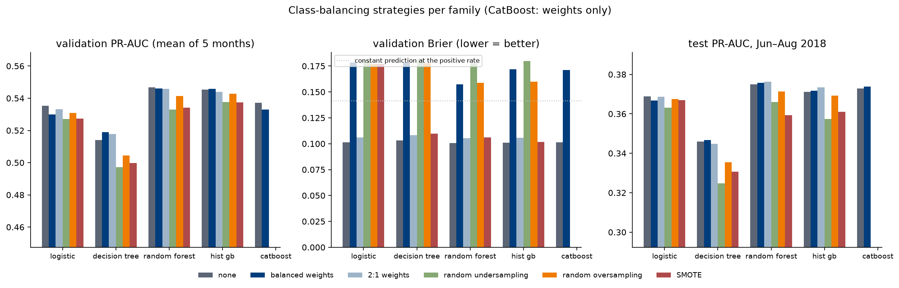

| Type | Family | Strategy | Train PR-AUC (CV) | Val PR-AUC | Δ vs balanced (months better) | Val Brier | Mean score (positive rate 0.168) | Val recall top 20% | Test PR-AUC | Test Brier | Rule |
|---|---|---|---|---|---|---|---|---|---|---|---|
| Linear | logistic | **none** | 0.476 | **0.5352** | +0.0053 (5/5) | **0.101** | 0.16 | 0.596 | 0.3689 | 0.088 | **chosen** |
| | | balanced weights | 0.473 | 0.5299 | ref | 0.179 | 0.44 | 0.595 | 0.3668 | 0.159 | |
| | | 2:1 weights | 0.475 | 0.5332 | +0.0034 (5/5) | 0.106 | 0.24 | 0.595 | 0.3687 | 0.100 | passes |
| | | undersampling | 0.470 | 0.5272 | −0.0026 (2/5) | 0.181 | 0.45 | 0.593 | 0.3631 | 0.160 | fails |
| | | oversampling | 0.474 | 0.5308 | +0.0010 (4/5) | 0.177 | 0.44 | 0.594 | 0.3675 | 0.158 | passes |
| | | SMOTE | 0.471 | 0.5274 | −0.0024 (0/5) | 0.177 | 0.44 | 0.588 | 0.3670 | 0.152 | fails |
| Single tree | decision tree | none | 0.493 | 0.5139 | −0.0051 (1/5) | 0.103 | 0.16 | 0.574 | 0.3459 | 0.090 | fails (PR-AUC) |
| | | balanced weights | 0.494 | **0.5190** | ref | 0.178 | 0.43 | 0.577 | 0.3466 | 0.163 | |
| | | **2:1 weights** | 0.493 | 0.5178 | −0.0012 (1/5) | 0.108 | 0.24 | 0.576 | 0.3448 | 0.104 | **chosen** |
| | | undersampling | 0.461 | 0.4972 | −0.0218 (0/5) | 0.181 | 0.44 | 0.579 | 0.3248 | 0.171 | fails |
| | | oversampling | 0.509 | 0.5045 | −0.0145 (0/5) | 0.178 | 0.43 | 0.567 | 0.3354 | 0.167 | fails |
| | | SMOTE | 0.457 | 0.4999 | −0.0191 (0/5) | 0.110 | 0.23 | 0.564 | 0.3307 | 0.102 | fails |
| Ensemble (bagging) | random forest | **none** | 0.558 | **0.5468** | +0.0007 (3/5) | **0.101** | 0.16 | 0.595 | 0.3750 | 0.088 | **chosen** |
| | | balanced weights | 0.567 | 0.5461 | ref | 0.157 | 0.40 | 0.594 | 0.3757 | 0.149 | |
| | | 2:1 weights | 0.564 | 0.5458 | −0.0003 (2/5) | 0.105 | 0.24 | 0.593 | 0.3762 | 0.101 | passes |
| | | undersampling | 0.505 | 0.5330 | −0.0130 (1/5) | 0.178 | 0.44 | 0.586 | 0.3659 | 0.164 | fails |
| | | oversampling | 0.632 | 0.5415 | −0.0046 (2/5) | 0.159 | 0.40 | 0.590 | 0.3712 | 0.151 | fails |
| | | SMOTE | 0.540 | 0.5341 | −0.0120 (0/5) | 0.106 | 0.23 | 0.581 | 0.3594 | 0.100 | fails |
| Ensemble (boosting) | HGB | **none** | 0.557 | 0.5454 | −0.0004 (2/5) | **0.101** | 0.16 | 0.591 | 0.3712 | 0.088 | **chosen** |
| | | balanced weights | 0.529 | **0.5458** | ref | 0.172 | 0.43 | 0.590 | 0.3717 | 0.161 | |
| | | 2:1 weights | 0.551 | 0.5440 | −0.0018 (2/5) | 0.106 | 0.24 | 0.588 | 0.3733 | 0.100 | passes |
| | | undersampling | 0.506 | 0.5376 | −0.0082 (0/5) | 0.180 | 0.44 | 0.589 | 0.3573 | 0.169 | fails |
| | | oversampling | 0.596 | 0.5429 | −0.0029 (1/5) | 0.160 | 0.40 | 0.589 | 0.3692 | 0.151 | passes |
| | | SMOTE | 0.555 | 0.5374 | −0.0084 (0/5) | 0.102 | 0.19 | 0.581 | 0.3610 | 0.091 | fails |
| Ensemble (boosting) | CatBoost | **none** | 0.545 | **0.5371** | +0.0041 (3/5) | **0.101** | 0.16 | 0.590 | 0.3728 | 0.088 | **chosen** |
| | | balanced weights | 0.535 | 0.5331 | ref | 0.171 | 0.43 | 0.591 | 0.3738 | 0.156 | |

**What the class-balancing study shows**
1. **Leaving the data as it is wins for four of five families** (logistic, forest, HGB, CatBoost).
   - The ranking is unchanged or slightly better: Δ PR-AUC −0.0004 to +0.0053.
   - Brier falls from 0.16–0.18 to 0.10 in every month.
   - The single decision tree is the exception: unweighted, it loses 0.0051 PR-AUC, just past the 0.005 tolerance, so mild 2:1 weights win there.
2. **Weights and resampling distort the probabilities but barely change the ranking.**
   - Balancing to 1:1 tells the model that half the orders are positive. Its mean score therefore rises to 0.40–0.45 against a true rate of 0.168, which is why Brier gets worse.
   - PR-AUC and recall in the top 20% depend only on the order of the scores, and that hardly moves: validation recall at 20% stays within 0.56–0.60 for every strategy.
3. **Random undersampling is the worst or joint-worst strategy in every family** (−0.003 to −0.022 PR-AUC; for HGB it ties with SMOTE).
   - To reach 1:1 it discards about 76% of the negatives (fold 1: 8,460 of 34,984 rows kept).
   - Its only advantage is speed: the forest fits in 10 s instead of 53 s per fold.
4. **Random oversampling makes the forest and the tree overfit.**
   - Duplicated positives appear in many bootstrap samples and leaves: forest training PR-AUC 0.632 against validation 0.542.
   - It loses 0.003–0.015 PR-AUC and gains nothing in Brier over no correction.
5. **SMOTE loses 0.002–0.019 PR-AUC.**
   - Synthetic orders interpolated between neighbours do not follow the real feature structure: one-hot categories become fractions and target-encoded ids become blends.
   - Its Brier is close to "none" for the tree models, but its ranking is worse. It would only help a model that needs a balanced sample and cannot take weights, which is not the case here.
6. **The test window confirms the pattern.**
   - Test PR-AUC for no correction vs balanced weights differs by at most 0.002 in any family.
   - Every resampling strategy scores 0.001–0.022 lower than no correction.
7. **Why imbalance is not the problem here.** At 15% positives the classes are only moderately imbalanced. The models are trained for ranking and judged by PR-AUC, and a calibrated probability is a bonus. Correcting the imbalance mainly re-scales the scores, and at the deployed top-20% rank rule a monotone re-scaling changes nothing.

**Effect on the model comparison.** The family comparison in §10 used the class treatment that each family carried into tuning:
- no weights for the forest and logistic regression;
- balanced weights for the tree, HGB and CatBoost.

Switching HGB and CatBoost to no weights changes their test PR-AUC by −0.0005 and −0.0010, so the comparison holds.

---

# Part B — experiments on top of v1

## 9. Experiments and their effect

### 9.1 Method

Each experiment changes **one thing** against the previous step's reference. It is scored on the same five folds and judged by a rule agreed with the team before the run:

| Experiment type | Kept only if |
|---|---|
| Features, training window, tuning | mean validation PR-AUC +0.010 or more, better in ≥ 4 of 5 months, recall in the top 20% not lower by more than 0.010 |
| Class balancing | Brier lower in ≥ 4 of 5 months, PR-AUC not lower by more than 0.005; lowest Brier wins |
| Calibration | Brier lower in ≥ 3 of 4 forward-chained months; isotonic may not lose more than 0.002 PR-AUC |
| Audit fix | always adopted |
| Label filter, daily-batch recall | reported only |

The +0.010 bar is deliberately strict: five monthly validations, many experiments and one random seed mean that differences of ±0.002 are noise.

### 9.2 Candidate feature groups (stored table `orders_features_v2.parquet`, 97,187 rows)

| Group | Features | Hypothesis (why it might help orders delivered on time) |
|---|---|---|
| item_structure | items per seller, item-price spread, top item's share of value, spread of shipping deadlines | split shipments and missing items cause complaints on orders that arrive on time |
| delivery_progress | seller shipping delay vs deadline, days in transit at T, days unshipped at T (all capped at T) | direct access to delivery progress |
| listing_quality | minimum photos, mean description length, mean name length | mismatch between the listing and the product |
| customer_history | earlier purchases by the same customer (strictly earlier) | repeat buyers review differently |
| quality_history *(pipeline)* | low-review rate of the category and of the product, product review count, low-review rate of the seller on on-time orders (all before the cut-off, as of purchase) | product quality, separate from lateness |

### 9.3 Ledger: every experiment and its effect

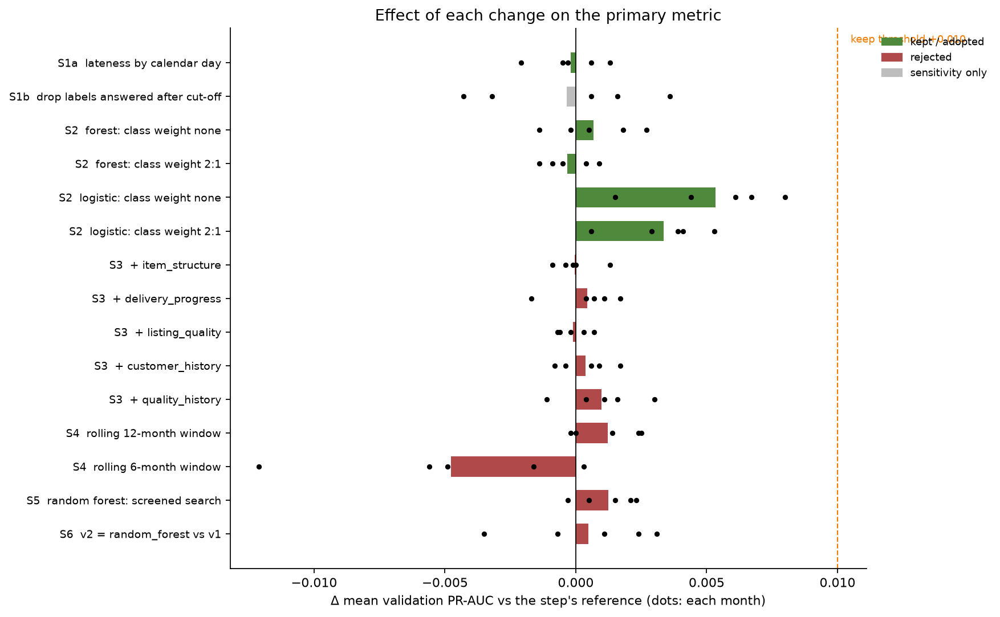

| Step | Experiment | Mean val PR-AUC | Δ PR-AUC | Months better | Δ recall top 20% | Δ ROC-AUC | Δ Brier | Δ PR-AUC, delivered by T | Decision | Test PR-AUC ² | Δ test PR-AUC ² |
|---|---|---|---|---|---|---|---|---|---|---|---|
| S0 | v1 forest, reproduced | 0.5463 | – | – | – | – | – | – | reference (matches the frozen run to 6e-17) | 0.3749 | – |
| S1a | lateness by calendar day | 0.5461 | −0.0002 | 2/5 | +0.0008 | −0.0006 | 0.0000 | +0.0001 | **adopted** (audit fix) | 0.3757 | +0.0008 |
| S1b | drop labels answered after the cut-off | 0.5457 | −0.0003 | 3/5 | +0.0007 | −0.0010 | −0.0001 | −0.0002 | reported only | 0.3752 | −0.0005 |
| S2 | forest: no class weight | 0.5468 | +0.0007 | 3/5 | +0.0007 | +0.0007 | **−0.0569** (5/5) | +0.0007 | **kept** | 0.3750 | −0.0007 |
| S2 | forest: 2:1 weights | 0.5458 | −0.0003 | 2/5 | −0.0011 | +0.0004 | −0.0520 (5/5) | +0.0006 | passes; higher Brier than none | 0.3762 | +0.0005 |
| S2 | logistic: no class weight | 0.5352 | +0.0053 | 5/5 | +0.0014 | +0.0003 | **−0.0771** (5/5) | +0.0014 | **kept** | 0.3689 | +0.0021 |
| S2 | logistic: 2:1 weights | 0.5332 | +0.0034 | 5/5 | +0.0003 | +0.0003 | −0.0723 | +0.0011 | passes; higher Brier than none | 0.3687 | +0.0019 |
| S3 | + item_structure | 0.5467 | −0.0000 | 1/5 | −0.0014 | +0.0001 | 0.0000 | −0.0013 | rejected | 0.3751 | +0.0002 |
| S3 | + delivery_progress | 0.5472 | +0.0004 | 4/5 | −0.0017 | −0.0002 | −0.0000 | +0.0001 | rejected | 0.3742 | −0.0008 |
| S3 | + listing_quality | 0.5466 | −0.0001 | 2/5 | +0.0012 | +0.0002 | 0.0000 | +0.0013 | rejected | 0.3756 | +0.0006 |
| S3 | + customer_history | 0.5471 | +0.0004 | 3/5 | −0.0003 | +0.0002 | −0.0000 | +0.0007 | rejected | 0.3745 | −0.0004 |
| S3 | + quality_history | 0.5477 | +0.0010 | 4/5 | +0.0007 | +0.0011 | −0.0000 | +0.0019 | rejected | 0.3741 | −0.0009 |
| S4 | rolling 12-month window | 0.5480 | +0.0012 | 3/5 | +0.0001 | −0.0002 | −0.0001 | +0.0004 | rejected | 0.3739 | −0.0011 |
| S4 | rolling 6-month window | 0.5420 | −0.0048 | 1/5 | −0.0015 | −0.0053 | +0.0003 | −0.0024 | rejected | 0.3782 | +0.0033 |
| S5 | forest: screened search | 0.5480 | +0.0012 | 4/5 | −0.0009 | +0.0002 | +0.0001 | −0.0006 | rejected: keep v1 hyperparameters | 0.3747 | −0.0002 |
| S6 | v2 (forest, calendar lateness, no weights) vs v1 | 0.5468 | +0.0005 | 3/5 | +0.0016 | +0.0001 | −0.0569 | +0.0008 | **v1 retained** | 0.3750 | +0.0000 |

² Secondary reference, added after every decision above and the v2 selection were frozen and hashed (`Ledger.add_test`). Each Δ uses the same reference as the validation Δ in that row. Refitting the S0 configuration reproduces the frozen v1 test PR-AUC (0.3749) exactly.

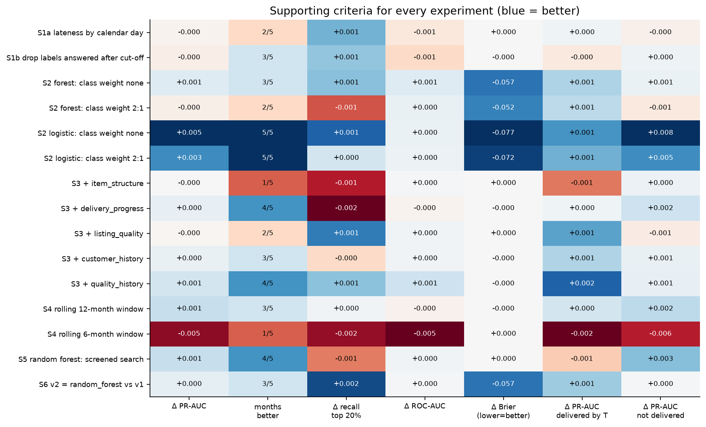

**Reading the ledger**
- **Features.** No group adds information the forest does not already have.
  - Delivery status at T carries 0.29 of the 0.37 total permutation drop (§11.4).
  - The best group, quality_history, adds +0.0010 overall and +0.0019 on orders delivered by T: a tenth of the bar.
- **Windows.** A 12-month window equals the expanding window. A 6-month window hurts (−0.0048), because the seller history needs the 2017 data.
- **Does the test window agree with validation?** Yes, in the sense that matters: nothing passes the bar on test either.
  - All 15 experiment Δs on test lie between −0.0011 and +0.0033. None comes within a third of +0.010.
  - The best test Δ is the 6-month window (+0.0033), which was the **worst** experiment in validation (−0.0048, better in 1/5 months). That is exactly what choosing on one window would get wrong: Jun–Aug 2018 happens to suit a short recent window, while the five validation months say it loses. It is a warning about drift between periods, not a reason to adopt it.
  - Feature groups: two of the five are slightly up on test and three slightly down; quality_history, the best in validation (+0.0010), is −0.0009 on test. At this size, the sign of a Δ is not reproducible between windows.
  - Removing class weights (S2) is neutral on test for the forest (−0.0007) and positive for logistic regression (+0.0021), matching validation's "no loss of ranking".

### 9.4 Training rows for each variant

Window and label-filter variants keep the fold cut-offs and drop rows (`experiments.train_rows`). All other variants train on the full expanding window.

### 9.5 Hyperparameter tuning in Part B

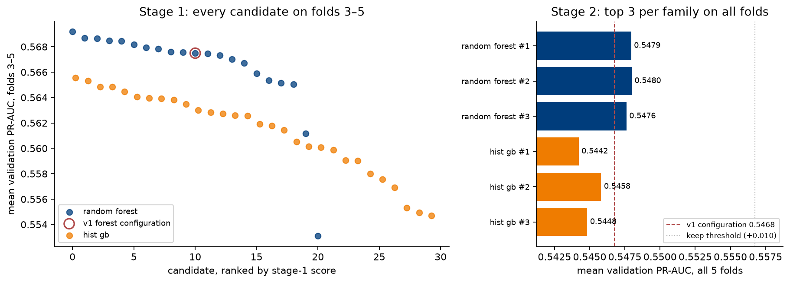

**Screened search** (`experiments.screened_search`), used for the random forest and HGB:
- **Stage 1.** Score every sampled candidate on folds 3–5. These have the largest training sets and are closest to deployment.
- **Stage 2.** Score the 3 best on all 5 folds; the best five-fold mean wins.
- This costs about 60% of a full five-fold search per candidate, so the budget can be wider than v1's 6 candidates. It is the successive-halving idea, with the number of folds as the resource.

| Family | Method and range | Candidates | Best | Mean val PR-AUC |
|---|---|---|---|---|
| Random forest | screened; n_estimators 200–600, max_depth 8–30, min_samples_leaf 5–150, max_features 0.15–0.65, **max_samples 0.5–1.0 (new)**; the v1 configuration included as a candidate | 21 | depth 22, leaf 147, max_features 0.55, max_samples 0.92, 241 trees | 0.5480 (v1 configuration 0.5468): Δ +0.0012, **rejected** |
| HGB | screened; learning rate 0.02–0.2 (log), max_iter 200–800 with early stopping, max_leaf_nodes 15–63, min_samples_leaf 20–300, L2 0.001–10 (log), max_features 0.3–0.9 | 30 | learning rate 0.021, 672 iterations, 21 leaves, leaf 139, L2 0.0099, max_features 0.68 | 0.5458 |
| Logistic | grid; C ∈ {0.001 … 1000} | 7 | C = 0.01 (flat for C ≥ 1) | 0.5352 |
| Decision tree | random; max_depth 3–12, min_samples_leaf 20–200 | 20 | depth 8, leaf 159 | 0.5190 |
| CatBoost | v1 best parameters (a new search costs about 15 min per candidate) | 1 | depth 4, 1000 iterations | 0.5331 |

**What tuning shows**
- In stage 1, the v1 configuration ranked 11th of 21, only 0.0017 below the top. The surface is flat around the strongly regularised region.
- HGB converges on the same region: slow learning rate, large leaves.
- More tuning is very unlikely to reach +0.010.

### 9.6 Stacking: one convex stack of linear + bagging + boosting (ST)

This is the classification counterpart of the regression team's Ridge/RF/HGB convex stack (`src/regression/extensions.py`), built the same way (`experiments.run_stacking`):

| | Regression stack | Classification stack |
|---|---|---|
| Base models | Ridge, random forest, HGB (tuned) | logistic regression, random forest, HGB (each family's tuned best, §9.5) |
| Combiner | non-negative weights summing to 1, no intercept | the same |
| Combiner loss | MAE (linear program) | log loss (SLSQP), the matching loss for probabilities |
| Combiner training rows | the last 3 months inside each outer training frame | the same: the last 3 T-months inside each fold's training rows |
| Outer validation scores | cached base predictions on the validation month | the same (`runs/` cache) |
| Keep rule | ≥ 1% lower mean validation MAE than the best single model | the Part B feature rule vs the best single model (random forest v2): +0.010 PR-AUC, better in ≥ 4/5 months |
| Test | not scored when discarded | scored afterwards as a **secondary** evaluation, as for every Part B model; the decision was saved first |

**Why inner months, not `StackingClassifier`.** `StackingClassifier(cv=5)` builds the combiner's training scores with shuffled K-fold, so it learns from orders that come after the ones it scores. Here, each inner month m trains the base models on orders with T before m − 27 days (history frozen at m) and scores orders with T in m whose label was known before the outer cut-off. The inner months never include the outer validation month. `stacking_inner_audit.csv` records, for all 18 inner windows, the row counts, the latest training T, the latest label used, and zero overlap. A unit test checks the same conditions.

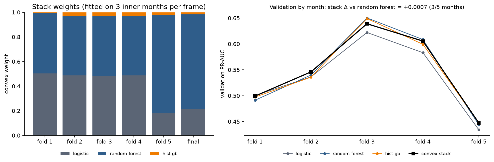

| Fold | Logistic weight | Forest weight | HGB weight | Combiner rows | Stack val PR-AUC | Forest v2 val PR-AUC | Δ |
|---|---|---|---|---|---|---|---|
| Jan 2018 | 0.50 | 0.49 | 0.00 | 9,990 | 0.4993 | 0.4913 | +0.0080 |
| Feb | 0.49 | 0.48 | 0.03 | 12,869 | 0.5460 | 0.5400 | +0.0061 |
| Mar | 0.49 | 0.48 | 0.03 | 14,134 | 0.6390 | 0.6502 | −0.0113 |
| Apr | 0.49 | 0.49 | 0.03 | 12,897 | 0.6055 | 0.6085 | −0.0030 |
| May | 0.19 | 0.79 | 0.02 | 14,043 | 0.4472 | 0.4438 | +0.0035 |
| **Mean** | | | | | **0.5474** | 0.5468 | **+0.0007 (3/5 months)** |
| Final model (test) | 0.22 | 0.77 | 0.02 | | | | |

**Decision: not retained.** +0.0007 PR-AUC and better in 3 of 5 months, far from +0.010 and 4/5. Recall in the top 20% is +0.004 and Brier is unchanged.

**Test (secondary).** PR-AUC 0.3784 against 0.3750 for the forest. A paired bootstrap (1,000 resamples) gives:
- PR-AUC Δ +0.0035 [+0.0010, +0.0060].
- Recall in the top 20% Δ +0.0051 [+0.0008, +0.0104].

The gain is detectable but small: a third of the agreed minimum, or about 12 more low-review customers among the 4,212 contacts. It also cannot overturn the validation decision, because choosing a model on the test window is exactly the misuse the protocol rules out.

**Why stacking adds so little**
- **The base models agree.** The Spearman correlation of out-of-fold scores is 0.88 (logistic vs forest), 0.89 (logistic vs HGB) and 0.92 (forest vs HGB). A stack helps only when models make different mistakes.
- **The combiner mixes the two most different models.** Logistic regression and the forest get about half the weight each, so the stack is mostly "linear + bagging".
- **HGB is almost ignored, but that is not because it ranks badly.** The tuned HGB uses balanced class weights, so its scores are inflated (mean 0.43 against a 0.16 positive rate), and a convex combination with no intercept is penalised by log loss for that inflation. HGB's ranking is 0.92-correlated with the forest's, so little information is lost.
- **Weights move in May.** May's combiner window is Feb–Apr 2018. Those are the months where the forest beat logistic regression most clearly (Mar 0.650 vs 0.622, Apr 0.609 vs 0.583), so the forest's weight rises to 0.79. The final model's window (Mar–May) gives similar weights (0.22 / 0.77 / 0.02).

### 9.7 Strict cut-off rerun (SC)

The [quality audit](quality_audit.md) found that v1's T-based split lets a few labels and features through that were not yet known at their cut-off (§13). This experiment reruns the whole v1 selection under explicit availability rules. It is versioned separately (`src/classification/strict.py`, `run_strict_cutoff.py`, outputs in `outputs/classification/strict_cutoff/`) and does not change any v1 or Part B result.

**The stricter rules**

| Rule | What it requires | Rows affected |
|---|---|---|
| R1 | A training label counts only if its review was answered before the fold's cut-off (on top of the 27-day gap) | 84 / 73 / 84 / 89 / 92 per fold; 82 of 70,136 in the final fit |
| R2 | Selection and thresholds use only validation labels answered before the 1 Jun 2018 selection date | 422 of 34,395 (May: 365 of 7,133) |
| R3 | If the approval or carrier event is recorded after T, `approval_lag_hours`, `carrier_handover_days` and `carrier_transit_days` are set to missing, in every split | 79 orders (34 in test) |
| R4 | A manifest (selection, thresholds, rules, data hash, source hashes) is frozen before test; the strict lock refuses a different manifest | — |

Everything else is v1's: the features, the families, the same candidates (seed 5006), the 27-day gap and the selection rule. Test labels are not filtered by R2, because the test evaluation is retrospective anyway. The validation labels dropped by R2 are not random: May labels answered after 1 Jun have a 21.6% low-review rate, against 11.6% for the rest of May.

**SC2 — effect of each rule with the v1 forest held fixed** (validation labels known by 1 Jun; `diagnostic_rules.csv`)

| Setting | Mean val PR-AUC | Δ vs v1 rules | Months better | Per-month Δ (Jan…May) |
|---|---|---|---|---|
| v1 rules | 0.5466 | — | — | — |
| R1 training labels only | 0.5452 | −0.0014 | 2/5 | +0.0017, −0.0029, −0.0047, +0.0019, −0.0030 |
| R3 event masking only | 0.5457 | −0.0009 | 1/5 | −0.0006, −0.0000, −0.0016, +0.0005, −0.0026 |
| **strict (R1 + R3)** | **0.5448** | **−0.0018** | 1/5 | +0.0013, −0.0015, −0.0045, −0.0002, −0.0039 |

Scoring all validation orders instead of only R2 rows changes these by less than 0.0004. The v1-rules row on all orders reproduces v1's saved fold results exactly (checked by the code). The leaked rows gave v1 a little help, about 0.002 PR-AUC, which is smaller than the fold SD (0.086) and a fifth of the agreed +0.010 threshold.

**SC3 — full reselection under the strict rules** (`cv_family_summary.csv`)

| Family | Strict CV PR-AUC | v1 CV PR-AUC | Same hyperparameters as v1 |
|---|---|---|---|
| **random forest** | **0.5460** | 0.5463 | no |
| CatBoost | 0.5310 | 0.5317 | yes |
| logistic (tuned, C = 0.01) | 0.5283 | 0.5294 | yes |
| logistic (base) | 0.5266 | 0.5278 | yes |
| decision tree | 0.5189 | 0.5186 | no |
| not delivered by T (baseline) | 0.3822 | 0.3832 | — |

- **The random forest is still chosen.** The family ranking is the same as v1.
- **The forest's hyperparameters changed:** depth 22, `max_features` 0.21, leaf 98, 381 trees, against v1's depth 14, 0.63, leaf 80, 302 trees. Six forest candidates fall within 0.011 of each other (0.5353–0.5460), so the change reflects a flat optimum, not a different model.
- **Gap sensitivity under R1** (`gap_sensitivity.csv`): mean CV PR-AUC 0.5507 with no gap, 0.5466 with the 21-day known-answer q99, 0.5460 with 27 days. Measured on answers known at 1 Jan 2017 only, the q99 review lag is 21 days, not 27; the 27-day gap is kept, so it is now slightly conservative.
- **What the model relies on** is unchanged: delivery at T (permutation drop 0.283) and order size (0.068) lead, as in v1.

**SC4 — test window (retrospective; v1 had already used it)** (`test_results.csv`, `paired_bootstrap.csv`)

| Model | Test PR-AUC | 95% CI | Recall in top 20% | Test ROC-AUC |
|---|---|---|---|---|
| **strict selection (random forest)** | **0.3738** | 0.355–0.396 | **0.535** | 0.7397 |
| v1 forest, v1 rules (reproduced) | 0.3749 | — | 0.532 | 0.7392 |
| v1 forest, strict rules | 0.3746 | — | 0.531 | 0.7393 |

Paired bootstrap against v1 (1,000 resamples of the same test orders):
- Strict selection − v1: PR-AUC Δ −0.0012 [−0.0043, +0.0018]; recall Δ +0.0030 [−0.0026, +0.0090].
- v1 forest under strict rules − v1: PR-AUC Δ −0.0003 [−0.0019, +0.0013]; recall Δ −0.0017 [−0.0054, +0.0038].

Both success criteria are met (PR-AUC 0.374 ≥ 0.225; recall 53.5% ≥ 50%). By month the strict model's recall is 51.8%, 48.5% and 56.9%, so July still misses the target, as with v1.

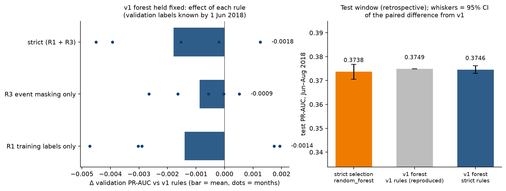

**Conclusion.** The availability leaks the audit found are real but immaterial. Removing them lowers validation PR-AUC by about 0.002, leaves the family choice unchanged, and changes test PR-AUC by −0.001 to −0.0003 with confidence intervals that include zero. v1 stays the headline. The strict rerun is the version whose numbers satisfy every availability rule, and it gives the same conclusions.

## 10. Results: train, validation by month, pooled validation and test, every model

Definitions:
- **Train** is the final model scored on its own training rows. It is optimistic by design.
- **Validation by month** is the five folds.
- **Pooled out-of-fold (OOF)** concatenates the five months' scores and scores them once.
- **Test** is Jun–Aug 2018. It is the single headline evaluation for v1 and a **secondary** evaluation for all Part B models (the window had already been seen once).

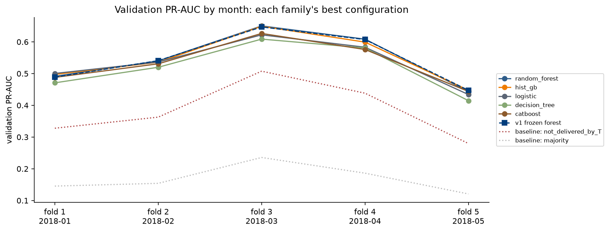

**Validation PR-AUC by month (each family's best configuration)**

| Type | Model | Jan | Feb | Mar | Apr | May | Mean |
|---|---|---|---|---|---|---|---|
| Ensemble (bagging) | v1 forest (frozen) | 0.4889 | 0.5407 | 0.6471 | 0.6074 | 0.4473 | 0.5463 |
| Ensemble (bagging) | random forest, calendar lateness, no weights (v2) | 0.4913 | 0.5400 | 0.6502 | 0.6085 | 0.4438 | 0.5468 |
| Ensemble (boosting) | HGB | 0.4974 | 0.5358 | 0.6491 | 0.5993 | 0.4476 | 0.5458 |
| Ensemble (boosting) | CatBoost | 0.4880 | 0.5309 | 0.6266 | 0.5760 | 0.4439 | 0.5331 |
| Linear | logistic regression | 0.5004 | 0.5364 | 0.6221 | 0.5831 | 0.4340 | 0.5352 |
| Ensemble (stacking) | convex stack: logistic + forest + HGB (§9.6) | 0.4993 | 0.5460 | 0.6390 | 0.6055 | 0.4472 | 0.5474 |
| Single tree | decision tree | 0.4709 | 0.5199 | 0.6087 | 0.5808 | 0.4147 | 0.5190 |
| Baseline | not delivered by T | | | | | | 0.3832 |
| Baseline | no skill | | | | | | 0.1684 |

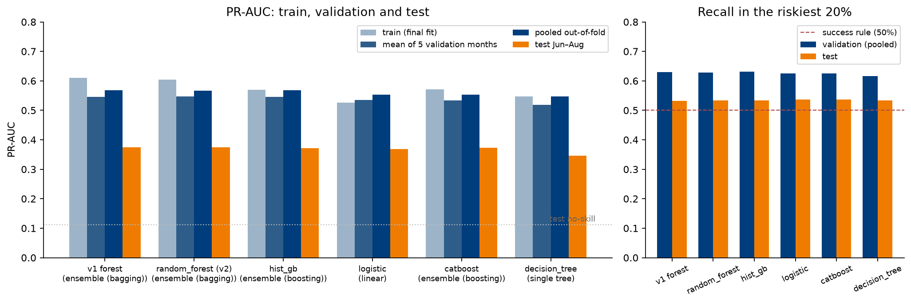

**Train → validation → test**

| Type | Model | Train PR-AUC | Mean val PR-AUC | Pooled OOF PR-AUC | Test PR-AUC | Test ROC-AUC | Test Brier | Test recall top 20% |
|---|---|---|---|---|---|---|---|---|
| Ensemble (bagging) | **v1 forest (headline)** | 0.610 | 0.5463 | 0.568 | **0.3749** | 0.7392 | 0.1492 (0.0900 after sigmoid) | **0.5323** |
| Ensemble (bagging) | random forest v2 | 0.604 | 0.5468 | 0.5673 | 0.3750 | 0.7397 | 0.0883 | 0.5335 |
| Ensemble (boosting) | HGB | 0.570 | 0.5458 | 0.5675 | 0.3717 | 0.7408 | 0.1606 | 0.5335 |
| Ensemble (boosting) | CatBoost | 0.572 | 0.5331 | 0.5537 | 0.3738 | 0.7398 | 0.1558 | 0.5373 |
| Linear | logistic regression | 0.526 | 0.5352 | 0.5539 | 0.3689 | 0.7377 | 0.0880 | 0.5361 |
| Ensemble (bagging) | random forest, strict cut-off rules (§9.7) | 0.599 | 0.5460 ² | – | 0.3738 | 0.7397 | 0.1526 | 0.5352 |
| Ensemble (stacking) | convex stack (not retained) | – ¹ | 0.5474 | 0.5675 | 0.3784 | 0.7417 | 0.0881 | 0.5386 |
| Single tree | decision tree | 0.548 | 0.5190 | 0.5471 | 0.3466 | 0.7282 | 0.1628 | 0.5335 |
| Baseline | not delivered by T | – | 0.3832 | – | 0.2099 | 0.6284 | – | 0.4057 |
| Baseline | no skill | – | 0.1684 | – | 0.1126 | – | – | 0.2000 |

¹ The stack has no single training fit. Its combiner's own training rows (the inner months) score PR-AUC 0.42–0.62.
² Scored on the validation labels answered by 1 Jun 2018 (R2), so not strictly comparable with the other rows; on the same rows the v1 forest scores 0.5466.

**v2 vs v1 on test.** Paired bootstrap, 1,000 resamples of the same test orders:
- PR-AUC Δ +0.0000 [−0.0016, +0.0017].
- Recall in the top 20% Δ +0.0013 [−0.0029, +0.0063].

**Comparing the families**
- **Ensembles vs a single tree.** The forest and HGB beat the decision tree by about 0.03 PR-AUC in every month. Averaging many trees removes the variance of one tree.
- **Ensembles vs logistic regression.** The gain is small: +0.011 in validation, +0.006 on test. Logistic regression even wins in Jan 2018. The signal is dominated by a few strong, mostly monotone features (delivered by T, delivery delay, number of items), which a linear model captures well. Logistic regression is a defensible, simpler alternative.
- **Bagging vs boosting.** The forest and HGB are tied; CatBoost is slightly lower in validation but equal on test.
- **Stacking.** Combining logistic regression with the forest gains +0.0007 in validation and +0.0035 on test. The models agree too closely (score correlation 0.88–0.92) for a stack to add much (§9.6).

**Overfitting.** Mean per-fold train − validation PR-AUC gap:

| v1 forest | forest v2 | CatBoost | HGB | decision tree | logistic |
|---|---|---|---|---|---|
| +0.021 | +0.011 | +0.002 | −0.017 | −0.025 | −0.059 |

- All gaps are small.
- Training and validation have different positive rates, so a negative gap does not mean underfitting: the Mar–Apr validation months have more positives than the training average.

**The drop from validation to test (0.55 → 0.37)** appears in every family, including the linear model, so it is a property of the test window, not of overfitting.
- About half of it is prevalence. Reweighted to the validation positive rate, v1's test PR-AUC would be 0.465. Relative to no skill, the ratio is 3.24× in validation and 3.33× in test.
- The rest is a real loss of separation: ROC-AUC 0.80 → 0.74. In Jun–Aug fewer orders are late at T (8.2% vs 10.5% in training), and late orders are less often unhappy (43% vs 63%).

**More v1 test detail** (`test_results.csv`, `test_by_month.csv`, `test_operating_points.csv`):
- **Confidence intervals.** PR-AUC 95% CI 0.356–0.397; recall in the top 20% CI 0.514–0.551. Precision in the top 20% is 0.300, a lift of 2.66.
- **By month.** PR-AUC 0.341 in Jun, 0.361 in Jul, 0.415 in Aug. No decay within three months.
- **Operating rule.** A probability threshold frozen in validation flags only 14.9% of test orders, because the scores shift with the lower positive rate. The rank rule (top 20% of each batch) keeps the contact volume at capacity.
- **Gap sensitivity** (`gap_sensitivity.csv`). Mean validation PR-AUC is 0.552 with no gap, 0.550 with k = 9 and 0.546 with k = 27. The gap costs about 0.006 and removes 1.1–1.9% of future labels.
- **Phase 2 random split, as a reference only** (`chronological_vs_random.csv`). The same model scores test PR-AUC 0.502 and ROC-AUC 0.788 under the random split. The random split is optimistic because its test months resemble its training months.

## 11. Further diagnostics

### 11.1 Orders delivered by T

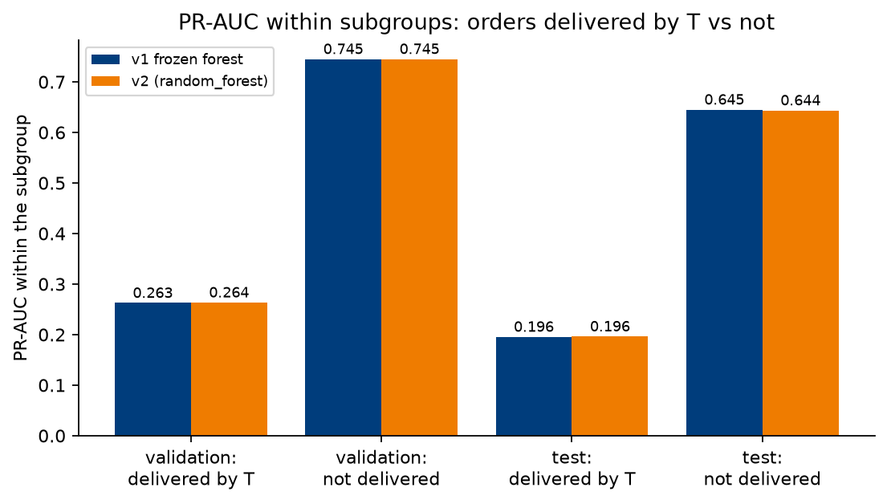

| Subgroup PR-AUC | v1 validation | v2 validation | v1 test | v2 test |
|---|---|---|---|---|
| delivered by T | 0.263 | 0.264 | 0.196 | 0.196 |
| not delivered by T | 0.745 | 0.745 | 0.645 | 0.644 |

No experiment moved the delivered-by-T PR-AUC by more than 0.002. Every leakage-free signal available at T was tried:
- item structure;
- delivery progress;
- listing quality;
- customer history;
- product, category and seller quality history.

Complaints about orders that arrive on time are about the product as received (quality, wrong item, mismatch with the description). The review text that would reveal this is written after T. This is a limit of the data, not of the model.

### 11.2 Calibration

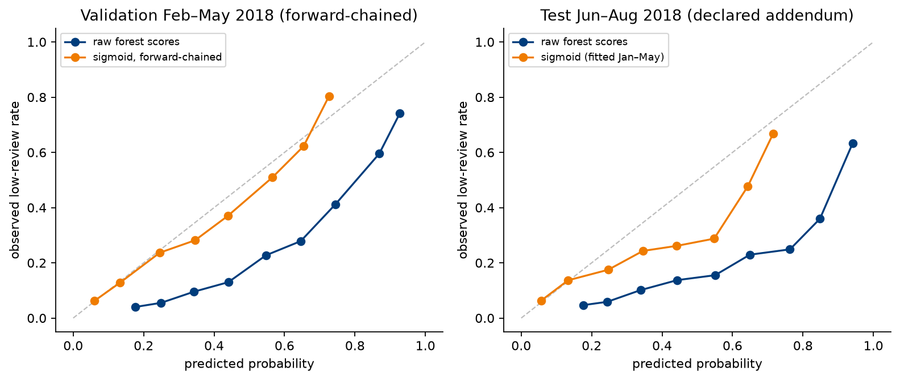

| Model | Method | Brier lower (forward-chained months) | Raw → calibrated Brier | Δ PR-AUC | Decision |
|---|---|---|---|---|---|
| v1 | sigmoid (Platt) | 4/4 | 0.158 → 0.101 | 0.000 | **keep** |
| v1 | isotonic | 4/4 | 0.158 → 0.101 | −0.019 | reject (tied scores cost ranking) |
| v2 | sigmoid | 1/4 | 0.102 → 0.102 | 0.000 | reject (already calibrated) |
| v2 | isotonic | 1/4 | 0.102 → 0.102 | −0.020 | reject |

- **Forward-chaining.** Month k is calibrated with a calibrator fitted on months 1 … k−1 only.
- **Deployed calibrator.** Fitted on all five months of OOF scores: `models/classification/calibrator_v1_sigmoid.joblib`.
- **Test.** v1 raw Brier 0.149; with sigmoid 0.090; v2 raw 0.088. A constant prediction at the validation rate gives 0.103.
- **Why v1 needs a calibrator.** Its balanced weights inflate the scores: mean OOF score 0.40 against a 17% positive rate. The unweighted forest's mean score is 0.16.

### 11.3 Daily batches (diagnostic)

The CX team ranks each day's orders, not a three-month window:
- Validation: pooled daily recall 0.567, against 0.630 for the whole window.
- Test: v1 0.518, v2 0.515.

Expect about 1.5–6 points less than the window-level figure in daily operation.

### 11.4 What the model relies on

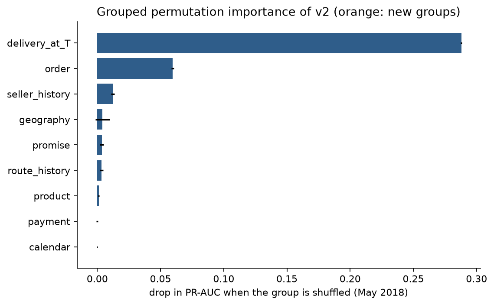

Grouped permutation importance on May 2018 (never on test): the drop in PR-AUC when a whole group is shuffled.

| Group | delivery at T | order | seller history | geography | promise | route history | product | payment | calendar |
|---|---|---|---|---|---|---|---|---|---|
| Drop | 0.288 | 0.060 | 0.012 | 0.004 | 0.004 | 0.003 | 0.001 | 0.000 | 0.000 |

The calendar group is worthless under a chronological split, so the Phase 2 calendar effect was period-specific (TA question).

## 12. Decision, deployment and business impact

1. **Headline result: v1.** Test PR-AUC 0.375 and recall in the top 20% of 0.532. Both criteria met.
2. **v2 is not recommended over v1.** It passes the class-balancing rule but not the +0.010 rule against v1, and the test bootstrap confirms no difference.
3. **Deployment.**
   - v1 plus the sigmoid calibrator. The model bundle is `models/classification/final_model.joblib`, used through `score.score_orders(orders, bundle)`, which returns `risk_score`, `risk_rank` and `flagged` (top 20% of the batch).
   - History features use events frozen at training time, so the app needs no other orders' outcomes.
   - Notes for the app builder are in `deployment/README.md`.
   - The unweighted forest (v2) is an equivalent alternative that needs no calibrator.
4. **Adopted fix.** Judge lateness by calendar day in any retraining.
5. **Business impact (test window).** 21,058 orders, 2,371 low reviews, 4,212 contacts at 20%.

   | Policy | Low-review customers reached | Share |
   |---|---|---|
   | Model, top 20% | ≈ 1,262 | 53% |
   | "Not delivered by T", filled to 20% at random | ≈ 962 | 41% |
   | Random 20% | ≈ 474 | 20% |

   At the same contact volume, the model reaches about 790 more unhappy customers than random contact. Whether contacting them improves the review is untested (an A/B test is needed).

## 13. Limitations and disclosures

- **Label and feature availability ([quality audit](quality_audit.md), 31 Oct).** All results here are saved retrospective results, not prospective estimates:
  - Training: 73–92 labels per fold, and 82 of 70,136 in the final fit, were answered after their cut-off. Dropping them changes validation PR-AUC by −0.0003 (S1b), but S1b was not adopted, so v1 and v2 still include them.
  - Validation: rows are chosen by T-month only. 422 of 34,395 validation labels (1.23%), including 365 of 7,133 in May (5.12%), were answered after the 1 Jun selection date, so selection and threshold estimation used answers that were not yet available.
  - Features: 61 orders have an approval event and 18 a carrier event recorded after T while the derived lag or transit feature is populated (79 orders, 34 in the test window).
  - The test lock compares a recorded selection ID; it does not fingerprint thresholds, source code or preprocessing. No change to these was found.
  - The audit recommended a separately versioned rerun with explicit label and event cut-offs. **Addressed in §9.7:** under those rules the forest is still chosen, validation PR-AUC is about 0.002 lower and test PR-AUC changes by −0.001 (CI includes zero). The strict lock (R4) fingerprints the selection, thresholds, data and source code. The v1 and Part B results are left as saved.
- **Daily queue not evaluated.** The 53.2% recall ranks the whole Jun–Aug window. By month it is 52.3%, 49.2% and 57.4%, so July misses the 50% target; the daily-batch figures in §11.3 are a diagnostic only.
- **Short history.** Training starts in Jan 2017, so seasonality cannot be learned or tested.
- **Drift.** Validation positive rates span 12–24%, including a disrupted month. Monitor monthly PR-AUC and recall at capacity.
- **Small margins.** Forest vs logistic regression is about 0.01 PR-AUC, inside the fold SD. The forest was chosen by the pre-set rule, not by a significant difference.
- **Selection on the same folds.** Features, windows, tuning and class balancing were all judged on the same five folds. The strict rules limit the multiple-comparison risk.
- **One seed per configuration.** Most experiment deltas (≤ 0.0012) are the size expected from seed noise. Seed variance was not measured.
- **Test window reused.** Part B's test numbers are a secondary evaluation of a window v1 had already used. v1 remains the headline.
- **The experiment rules were agreed before the run**, and the code applies them (`experiments.keep_*`). The written plan was not committed to git before the run.
- **CatBoost** was not re-tuned in Part B and was compared on class weights only. It is not a stack base model, to keep the stack the same as the regression one.
- **Stacking is not fully nested.** The base hyperparameters were tuned on the same five validation months. This favours the stack slightly, and it still did not pass.
- **The 20% capacity** is a staffing assumption set by the team, not validated with the business.

## 14. Changes from Phase 2 and the TA feedback they answer

| TA feedback | Change |
|---|---|
| Time-series data must be evaluated chronologically; this should be the primary approach | Chronological expanding-window validation and a Jun–Aug 2018 test window. The random split is kept only as a reference (`reference` stage) |
| Do not use the held-out test set for development or selection | Hash lock; selection frozen before scoring; interpretation on May 2018; Part B evaluations labelled secondary |
| Compare model families on the same features and preprocessing | One history step and one preprocessor per model kind for all families |
| Report search ranges and training scores | `search_spaces.csv`; training scores for every candidate, fold and final model |
| Define a measurable success criterion and the operating target | Two criteria fixed before testing; top-20% rank rule |
| Re-check the calendar group under a chronological split | Calendar split from promise; permutation drop 0.0002 (v1), 0.000 (v2) |
| (Phase 2 limitation) ensemble and resampling studies were random-split only | Ensembles (forest, HGB, CatBoost), a chronological stack (§9.6) and resampling (§8) re-run chronologically |

**Other changes**
- Cohort filtered by T instead of purchase month: 97,187 orders.
- `black_friday_week` dropped.
- Geography helpers moved to `src/common/geography.py`.
- CatBoost early stopping replaced by searching the number of iterations.

## 15. Decision log

| ID | Decision | Reason |
|---|---|---|
| D1 | The chronological split is the main evaluation; the random split is a reference | TA requirement |
| D2 | Time axis = T = min(delivered, estimated delivery) | The model is used at T |
| D3 | 5 expanding folds (Jan–May 2018); test Jun–Aug 2018 | Mean and SD over months; the latest three months held out |
| D4 | Purge gap 27 days (q99 of review lag after T, 2017 data) | Removes most labels from the future; it does not remove all of them (0.12–0.24% per fold), and it drops slow-answered reviews, which are more often low (§9.7) |
| D5 | 2016 excluded | 303 orders |
| D6 | History features refitted per fold, frozen at the cut-off | A model trained at the cut-off cannot know later outcomes |
| D7 | `black_friday_week` dropped | Constant in every validation and test month |
| D8 | Success criteria fixed before any chronological result | TA request |
| D9 | Operating rule: top 20% by rank | Positive rate drifts; a fixed threshold changes the contact volume |
| D10 | Selection by highest mean validation PR-AUC over the 5 folds | Primary metric; rewards stability across months |
| D11 | Test window scored once per frozen selection | TA requirement |
| D12 | Interpretation on May 2018, not on test | Keeps test for assessment only |
| D13 | Part B keep rules: +0.010 PR-AUC in ≥ 4/5 months (features, windows, tuning); Brier rule (class balancing, calibration) | Agreed by the team before the run |
| D14 | Lateness judged by calendar day | Audit finding (1,265 same-day deliveries mislabelled) |
| D15 | v1 stays the headline; deploy v1 + sigmoid calibrator | No experiment passed the rule against v1 |
| D16 | Convex logistic/forest/HGB stack, combiner trained on 3 inner months per fold; not retained | Mirrors the regression stack; +0.0007 validation PR-AUC, 3/5 months |
| D17 | No reduced (quick) run mode | Every reported number must come from the full data and full search budgets |
| D18 | Every ledger experiment is also scored on test, after the freeze, as a reference only | A second, independent check on the validation decisions; it never re-selects |
| D19 | Strict cut-off rerun (R1–R4) kept as a separate version; v1 stays the headline | Quality-audit findings; the strict rules change validation PR-AUC by −0.002 and test PR-AUC by −0.001 (CI includes zero), so the conclusions do not change |

## 16. Code and file map

| File | Role |
|---|---|
| `src/classification/config.py` | paths, feature lists and groups, folds, success criteria, seed |
| `data.py`, `features.py` | load the CSVs, build the order table and the outcome-free features; `HistoryInPipeline` |
| `splits.py` | T-based expanding folds, purge gap, final split, test-id hashing |
| `models.py` | `make_preprocessor` (all model kinds), `CatBoostSKClassifier`, `Resampled`, v1 families and search ranges |
| `search.py` | v1 expanding-window search loop |
| `evaluate.py` | PR-AUC, ROC-AUC, Brier, recall / precision at capacity |
| `pipeline.py`, `run_pipeline.py` | Part A stages and their command line |
| `figures.py` | v1 figures 01–05 |
| `score.py` | deployment scoring interface |
| `experiment_features.py` | candidate feature groups, calendar-day lateness, `HistoryV2` |
| `experiments.py`, `run_experiments.py` | Part B: `Variant`, cached fold and final fits, keep rules, screened search, calibration, test window, class-balancing study, stacking (`inner_folds`, `convex_weights`, `run_stacking`) |
| `experiment_figures.py` | figures E01–E12 |
| `strict.py`, `run_strict_cutoff.py` | strict cut-off rerun (§9.7): rules R1–R3, cached fits, rule diagnostic, reselection, frozen manifest and strict test lock (R4), figure SC1 |
| `tests/test_classification.py`, `tests/test_experiments.py`, `tests/test_strict_cutoff.py` | protocol, leakage and strict-rule tests |
| `notebooks/classification_chronological.ipynb` | executed v1 results |
| `notebooks/classification_experiments.ipynb` (built by `build_experiments_notebook.py`) | executed Part B results |

| Output | Content |
|---|---|
| `outputs/classification/tables/` | v1: cohort, folds, candidates, CV, test, operating points, random split, importance |
| `outputs/classification/experiments/tables/` | Part B: `ledger.csv` (validation and test for every experiment), `per_fold.csv`, searches, `class_balance.csv`, `stacking_folds.csv`, `stacking_inner_audit.csv`, `test_results_v2.csv`, calibration, bootstrap, daily recall, importance |
| `outputs/classification/experiments/runs/` | cached fold and final results (lets a rerun skip finished work) |
| `outputs/classification/experiments/stacking.json` | stack decision, weights, test scores and bootstrap |
| `outputs/classification/strict_cutoff/` | strict rerun: `strict_rules.json`, `selection_strict.json` (manifest), `test_lock_strict.json`, `test_summary_strict.json`; tables (fold table, rule diagnostic, candidates, gap sensitivity, test results, bootstrap); `runs/` cache; `predictions/`; figure SC1 |

*AI tool declaration:* code and documentation were drafted with Claude (Anthropic) under the team's direction; the team reviewed the protocol, the rules and the results.
