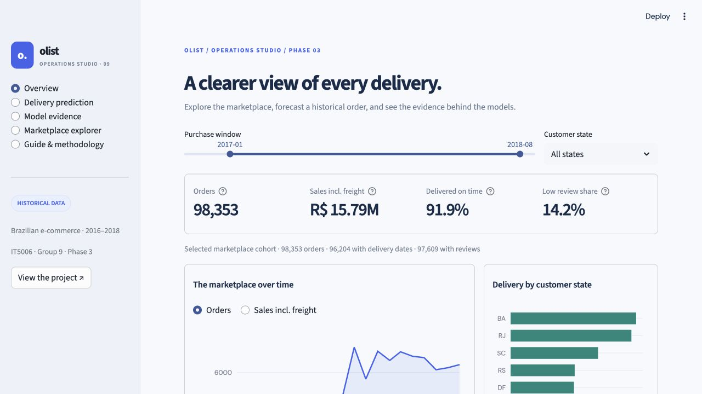
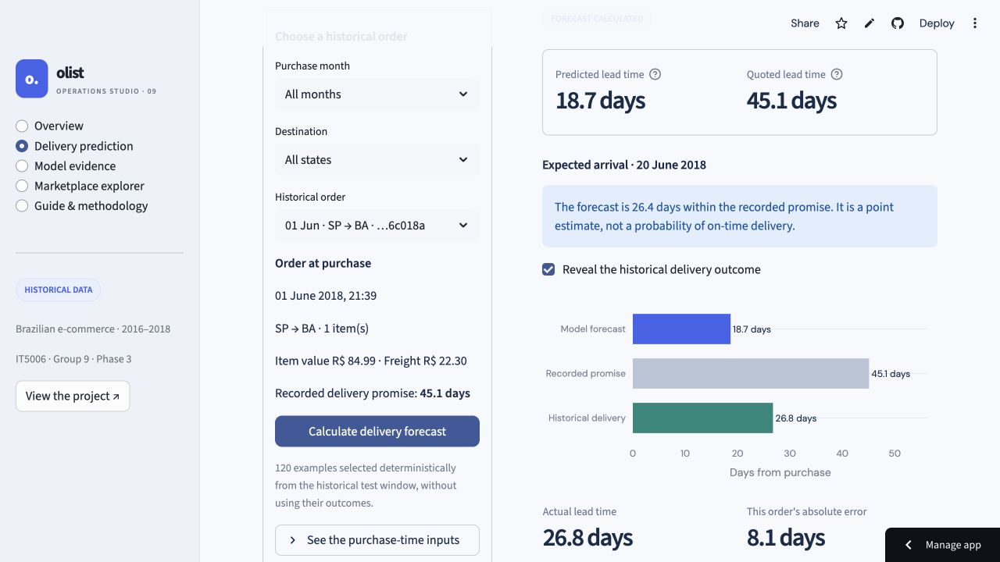
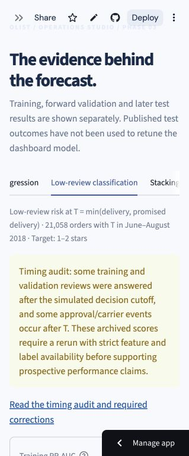

# Dashboard screenshots

Captured from the [deployed Phase 3 application](https://it5006-group9-olist-project-c5hmxth6jt543wszxqoaqd.streamlit.app/)
after online browser checks on 31 October 2026.
The model demonstration executes the fitted regressor, then optionally reveals
the held-out historical delivery outcome. The screenshots may be reused in the
presentation and deployment section of the report.

## Overview

## Real prediction and revealed historical outcome

## Classification timing audit notice

Captured after the audit update and Cloud reboot. The archived scores remain visible with a notice that strict feature and label availability require a new assessment. The regression evidence page also displays the saved selection-maturity and duration-tail diagnostics.

See the [dashboard guide](../../../dashboard/README.md) for setup, prediction
semantics, evaluation sources and limitations.
