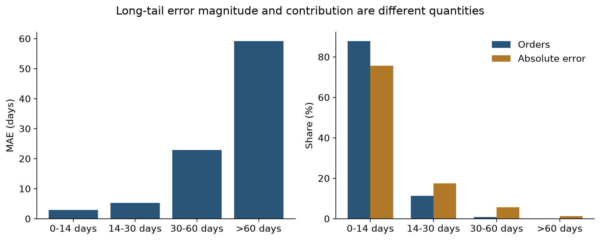

# Delivery lead-time regression

## 6. Experimental design

### 6.1 Prediction task and study population

Delivery lead time was defined as fractional days from purchase to customer receipt. Predictions are made at purchase to support customer-service arrival estimates and fulfilment planning. The fixed course dataset yielded 96,470 delivered orders with valid, non-negative durations and line-item information. Restricting purchases to January 2017–August 2018 produced 96,203 orders. Valid long deliveries were retained. Evaluation therefore concerns observed completed deliveries, rather than all placed, cancelled or unresolved orders.

### 6.2 Chronological validation and label availability

Following the feedback on Phase 2, chronological evaluation replaced random splitting as the main procedure. Five expanding windows validated purchases in January–May 2018, with training beginning in January 2017. The final model was fitted as of 1 June and evaluated on 18,603 June–August purchases. Its training set contained 68,916 orders.

A 39-day embargo was fixed from the rounded-up 99th percentile of durations for 2017 purchases delivered before 1 January 2018. Training eligibility required both purchase before the forecast origin minus 39 days and receipt before that origin. The second condition excluded a further 43–133 pending labels per validation fold and 52 from final training. Thus, a date gap alone was not treated as proof of label availability.

Model selection used only validation outcomes observed before 1 June. An order could complete after its purchase month and still be evaluated if its outcome was known by selection. The resulting five monthly validation counts were 7,068, 6,551, 6,996, 6,715 and 4,406. The last count covers only 65.3% of eventual completed May orders, so selection underrepresents late-May and slow deliveries. MAE, in days, was the primary criterion: the unweighted mean of the five monthly MAEs, with sample SD describing variation across months. Test MAE and RMSE pooled all June–August test orders; these are different aggregation rules and periods.

### 6.3 Leakage controls and scope of verification

Actual receipt, realised duration, final order status, reviews, approval and carrier timestamps were excluded from predictor selection. Imputation, scaling and category dictionaries were fitted within each training partition. The auxiliary slow-order score used past-only monthly cross-fitting within each regression training partition; initial January–March 2017 rows received zero plus an unavailable-score indicator. No Phase 2 random-fold probabilities were reused.

A final audit independently reconstructed the 96,203 targets and dates and all training/validation memberships. It found no unavailable training or selection labels. Perturbing post-purchase outcome fields left all 98,666 purchase-feature rows unchanged; deleting or perturbing outcome fields also left predictions unchanged for 160 sampled test orders. Saved preprocessing states and risk/stacking time boundaries were checked. These checks found no direct target or future-label leakage in the reviewed paths. However, quote, item, seller and product attributes are archived snapshots whose purchase-time availability is assumed; the static geography reference has no historical version log. The audit cannot establish their original availability from event records that the dataset does not contain.

## 7. Regression modelling

### 7.1 Baselines, preprocessing and model search

Training-mean, training-median and quoted-promise predictions provided reference baselines. Learners comprised OLS and Ridge, a single decision tree, Random Forest (RF), and histogram gradient boosting (HGB). The primary comparison shared purchase-time inputs and preprocessing: quoted duration, geography and routes, order/basket attributes, seller identity, product characteristics and cyclical calendar features. Numerical features used training medians and standard scaling; categorical features used training-mode imputation and one-hot encoding with infrequent-category pooling. Predictions were constrained to non-negative days.

The bounded search evaluated 23 configurations across five months: one OLS, four Ridge penalties, four single trees, six forests and eight HGB settings. Ridge penalties were 1, 10, 100 and 1,000; tree depth/leaf-size pairs used {6, 10} × {30, 100}; RF used depths {12, 20, unrestricted} × leaf sizes {30, 80}. HGB used {15, 31, 63, 127} leaves × L2 penalties {1, 10}. All primary targets remained on the original day scale. OLS, Ridge, the tree and RF used squared-error fitting, while HGB used absolute-error loss; the comparison therefore concerns learner-and-loss designs at matched inputs, rather than an isolated algorithm effect.

### 7.2 Feature variants and selected configuration

Separate fixed-HGB comparisons removed calendar inputs, added absolute dates, or added a predicted probability of delivery exceeding 30 days. The risk score is a learned representation of purchase information, not the actual slow-order label of the order being predicted. RF log-target fitting and zero/26-day gaps were supplementary checks, with strict label availability retained.

The selected HGB with risk had mean validation MAE 5.2595 days, compared with 5.4140 for the common-input HGB, 5.3492 without calendar inputs and 5.6875 with absolute dates. Its configuration used absolute-error loss, 300 iterations, learning rate 0.05, 15 leaves, minimum leaf size 30, L2 penalty 1 and no early stopping. The auxiliary HGB classifier used 120 iterations, learning rate 0.05, 15 leaves, minimum leaf size 50 and L2 penalty 10. Model randomness used seed 5006.

### 7.3 Chronological stacking experiments

An initial convex Ridge/RF/HGB stack learned non-negative, unit-sum weights without an intercept from three forward inner windows within each outer training partition. Base settings had been chosen using the main validation procedure, so this was not fully nested hyperparameter selection. Its validation MAE was 5.2971 days, failing the predeclared requirement of at least 1% improvement over the best single model; no final test fit was made for this initial stack.

A subsequent experiment migrated all 14 Phase 2 ensemble variants, including equal means, to the chronological protocol. Inner predictions, candidate selection and weights were rebuilt using past-only partitions. The lowest validation MAE among the combinations was 5.3700 for the fixed three-member mean; the best learned stack was the fixed Ridge–RF pair at 5.4181. Both were worse than the main HGB with risk. This suite retained its historical feature packs and the 63-leaf Phase 2 HGB specification, so it is distinct from the matched-input comparison and the 15-leaf main model.

## 8. Evaluation and interpretation

### 8.1 Main results and model decision

**Table R1. Main regression comparison. All errors are in days.**

| Model | Train MAE | CV MAE ± SD | Test MAE | Test RMSE |
|---|---:|---:|---:|---:|
| Training mean | 6.7601 | 7.1924 ± 0.9719 | 6.6006 | 7.7145 |
| Training median | 6.4825 | 6.8824 ± 1.6711 | 5.0603 | 6.4338 |
| Delivery promise | 12.6190 | 11.9915 ± 1.5318 | 12.7181 | 15.4296 |
| OLS | 5.2297 | 5.2900 ± 1.2186 | 3.9111 | 5.5855 |
| Ridge | 5.2397 | 5.2702 ± 1.2454 | 3.8623 | 5.5181 |
| Single tree | 5.3562 | 5.5319 ± 1.4980 | 4.2815 | 5.6757 |
| Random Forest | 5.0905 | 5.4044 ± 1.4978 | 4.1841 | 5.5942 |
| HGB, without risk | 4.7921 | 5.4140 ± 2.0494 | 3.3969 | 5.0375 |
| HGB, with risk (selected) | 4.7190 | 5.2595 ± 1.6386 | 3.4343 | 5.0925 |

Train scores are in-sample on the final training population; risk-HGB training scores use the cross-fitted risk inputs used during fitting. CV is the mean ± sample SD across five monthly windows, not a confidence interval or a separate random validation set. Each mean/median reference is calculated from its corresponding training window.

The selected model achieved test MAE 3.4343 days, RMSE 5.0925 days, R² 0.2347 and 55.93% of forecasts within ±3 days. MAE was 32.13% below the training-median reference and below the promise baseline, meeting the two project-defined criteria of at least 5% improvement over the median and improvement over the promise. These criteria were not business-validated service levels.

Selection remained based on validation, although the no-risk HGB achieved a slightly lower test MAE of 3.3969. The selected model's validation advantage over Ridge was only 0.0107 days. Excluding May from the aggregation changed its rank from first to eighth, while Ridge became first. This sensitivity and the large monthly variation limit claims of consistent HGB superiority. Post-selection analysis also found May MAE of 2.8003 on selection-time observed outcomes versus 4.4222 on eventual completed outcomes; this diagnosis did not revise selection.

### 8.2 Supplementary ensemble assessment

The validation-selected two-member stack and three-member mean were subsequently assessed on the same 18,603 historical test orders, together with their standalone members. The learned stack used Ridge weight 0.6282 and RF weight 0.3718, fitted on 18,422 forward OOF rows whose labels were known before 1 June. The mean used one-third weights.

**Table R2. Supplementary assessment of migrated ensembles and their members. All errors are in days.**

| Procedure / member | CV MAE | Test MAE | Test RMSE |
|---|---:|---:|---:|
| Learned Ridge–RF stack | 5.4181 | 4.3875 | 5.8603 |
| Equal Ridge–RF–HGB mean | 5.3700 | 3.9275 | 5.4741 |
| Fixed Ridge member | 5.4586 | 4.4802 | 5.9667 |
| Fixed RF member | 5.4871 | 4.4352 | 5.8635 |
| Migrated HGB63 member | 5.5184 | 3.4217 | 5.1963 |
| Main HGB with risk (saved reference) | 5.2595 | 3.4343 | 5.0925 |

The main-model row reuses its original saved assessment; the other rows belong to the later supplementary experiment. The migrated HGB63 and main HGB use different representations and settings. The ensemble tests did not change the frozen model or deployment decision. Earlier Phase 2 work and the original Phase 3 assessment had already exposed this test window; these results are supplementary retrospective evidence, not a new independent holdout. The HGB63 test score is not grounds for post-test reselection.

### 8.3 Error patterns and predictor reliance

Monthly test MAE was 3.70, 3.62 and 3.00 days for June, July and August, with overall average overprediction of 1.01 days. Long deliveries remained difficult (Figure R1). The 157 orders lasting 30–60 days had MAE 22.95 days, and the 14 above 60 days had MAE 59.14 days. Together, orders above 30 days represented 0.92% of test orders and 6.94% of total absolute error. These outcome-defined groups are diagnostics, not purchase-time routing rules.

**Figure R1. Test error by actual duration.** Group MAE measures error per order; order share and share of total absolute error measure prevalence and aggregate contribution. Despite severe individual errors, the >30-day tail does not dominate aggregate error in this test period.

On 3,000 May validation orders with outcomes known by selection, grouped permutation increased MAE most for geography (+1.0290 days), followed by the promise (+0.1527) and calendar (+0.0512). Auxiliary risk was recomputed after each source-group permutation. These figures describe predictive reliance in that conditional May sample, not causal effects or general feature values across all months.

The lower chronological test MAE must not be presented as an isolated improvement over Phase 2. Mean actual duration was 8.63 days in the chronological test versus 13.69 in final training; the share exceeding 30 days fell from 5.87% to 0.92%. A fixed-configuration random reference scored MAE 4.5868 on a different mixture and training population. Changed outcome mix, label maturity and training eligibility prevent attributing these score differences solely to the model or split method.

### 8.4 Practical use and remaining limitations

The model provides provisional arrival estimates rather than guaranteed delivery dates. The deployed historical-order demonstration uses a refit of the frozen specification, keeps realised outcomes separate from prediction inputs and reveals them only for comparison. Residual long-tail error, changing route/month mix, limited seasonal history, archived-field availability assumptions and completed-delivery selection constrain broader use. A future independent evaluation should predefine sufficiently mature validation periods and observation horizons before choosing another model; operational benefits would require prospective monitoring and an intervention study.
