# Dashboard screenshots

Captured from the [deployed Phase 3 application](https://it5006-group9-olist-project-c5hmxth6jt543wszxqoaqd.streamlit.app/)
after online browser checks on 31 October 2026.
The model demonstration executes the fitted regressor, then optionally reveals
the held-out historical delivery outcome. The screenshots may be reused in the
presentation and deployment section of the report.

## Overview

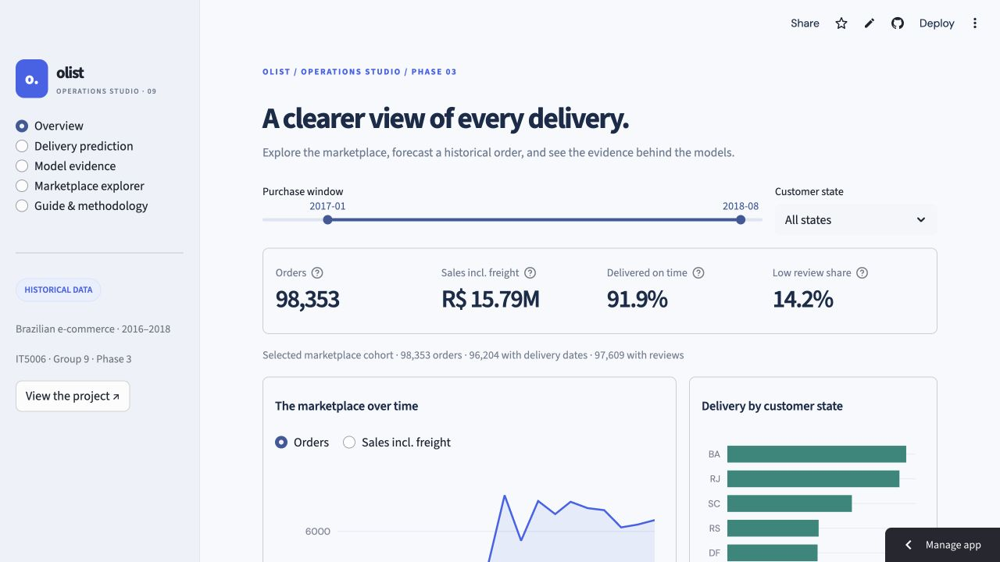

## Shared filters and mobile layout update

The updated Overview and Marketplace explorer retain the same selection across
page changes. Both offer Reset all filters, and Overview shows extra conditions
set in the explorer. At 360 px the sidebar starts collapsed and the four summary
metrics use a two-column layout.

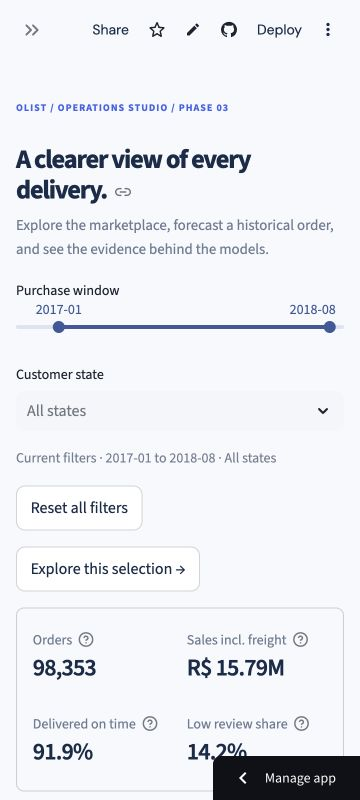

## Historical example navigation

Previous, Next and Random browse within the current month and destination.
Changing an order or leaving the prediction page clears its forecast and revealed
outcome. The screenshot shows a real prediction with the outcome still hidden.

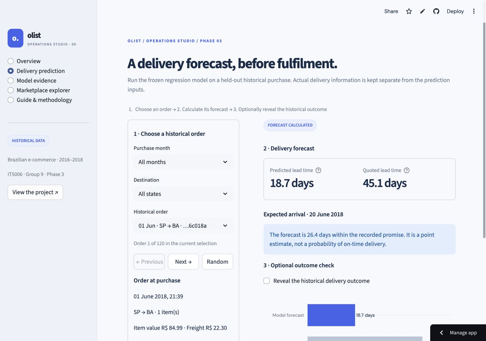

## Real prediction and revealed historical outcome

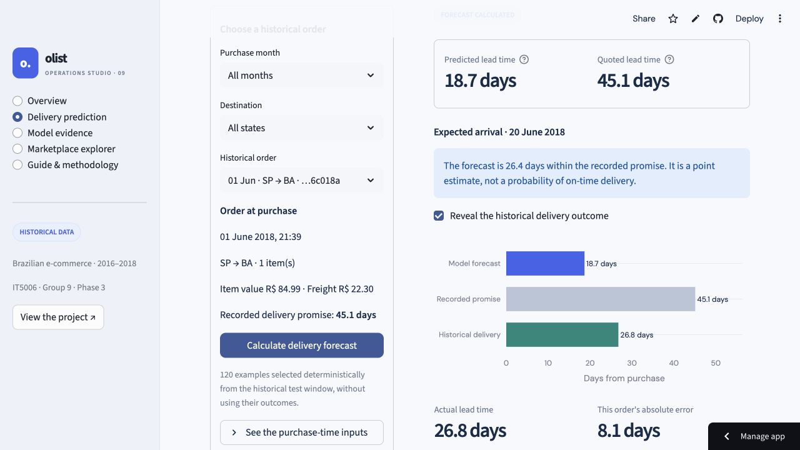

## Regression input explanations

The full-width purchase-time input table now shows each field, its recorded value,
and a plain-language definition with units. All 41 displayed fields are covered;
long definitions wrap instead of being truncated.

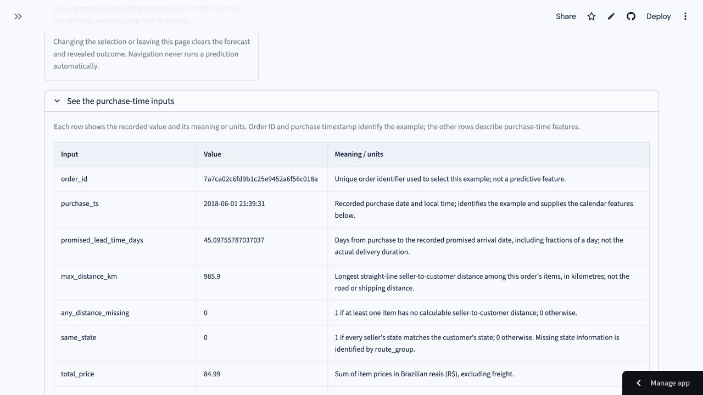

## Classification timing audit notice

Captured after the audit update and Cloud reboot. The archived scores remain visible with a notice that strict feature and label availability require a new assessment. The regression evidence page also displays the saved selection-maturity and duration-tail diagnostics.

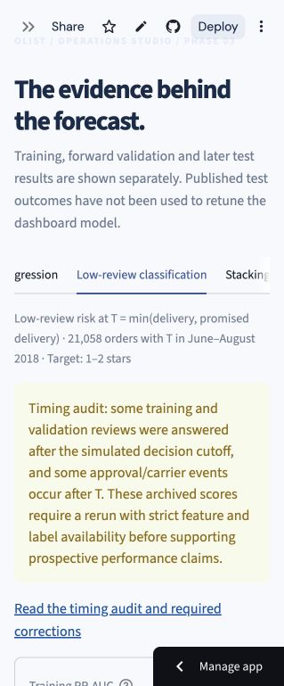

## Updated classification evidence

The latest upload keeps v1 as the headline and adds the strict-cutoff rerun,
Part B family comparisons, classification stacking, daily capacity and calibration
diagnostics. The assessment selector changes the score cards, operating thresholds,
monthly curve, criteria and download together. These supplements reuse the
historically examined test window.

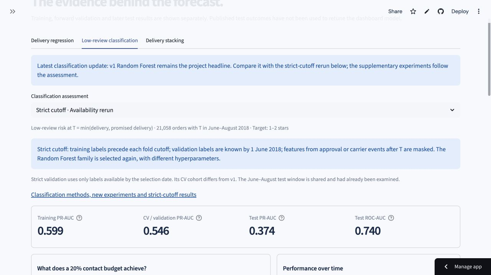

The earlier timing-audit screenshot above is retained as a historical record.
The current interface acknowledges that the strict rerun has been completed.

## Interactive low-review prediction

Current interface (5 November 2026): V1 is the final model used by Overview,
prediction and the main results. The strict-cutoff comparison is folded under
Model results. The screenshots below retain the earlier interface as a dated record.

Captured on 3 November 2026 after the teammates uploaded both fitted model
bundles. The new **Low-review prediction** workspace runs either forest on a
selected fixed historical example. Strict cutoff is the demo default; the score
is compared with that model's frozen validation threshold. The actual review
stays hidden until the reveal action. All 49 displayed input fields have meanings
and units in the expandable table.

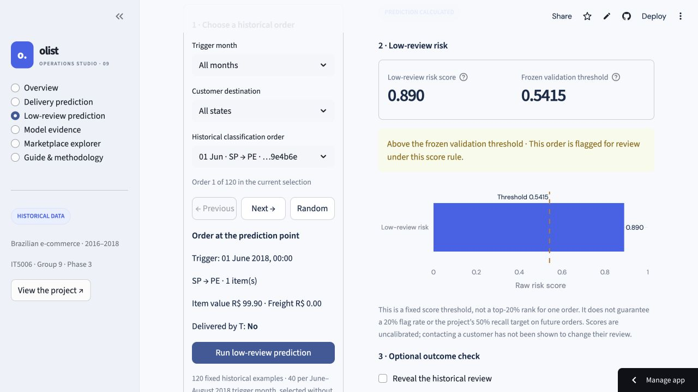

Both model versions, review reveal, prediction-only CSV download, state clearing
and the existing regression forecast were checked on the original Cloud URL.
The [classification deployment record](../../deployment/classification_live_verification.json)
separates these browser checks from local tests and numerical export verification.

The subsequent dashboard self-audit corrected obsolete interaction wording,
clarified the classification cohort and missing values, and made optional delivery
outcome reads independent of prediction. Model identity and score interpretation
now sit beside the classification result. The
[follow-up verification](../../deployment/self_audit_verification.json) includes
four fault-injection tests and a 360 px layout check.

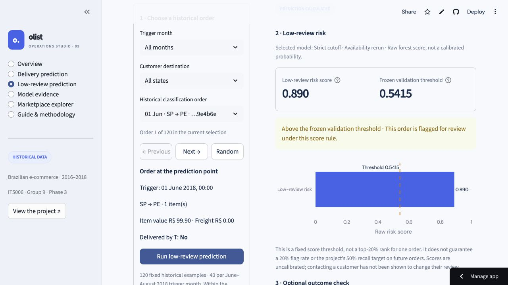

## Filtered chart corrections

The next audit reproduced a February 2018 RJ/computer-accessories cohort with
114 orders, 111 reviews, a 2.88 mean rating and R$17,116.14 in sales. Small sales
now show their actual amount, and the mean-rating bar remains visible below
three stars on a complete 0–5 axis.

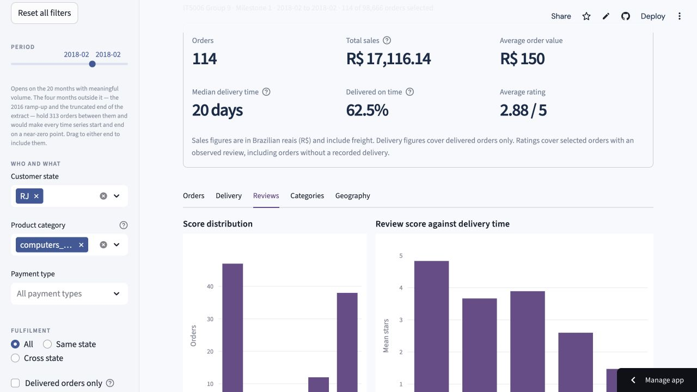

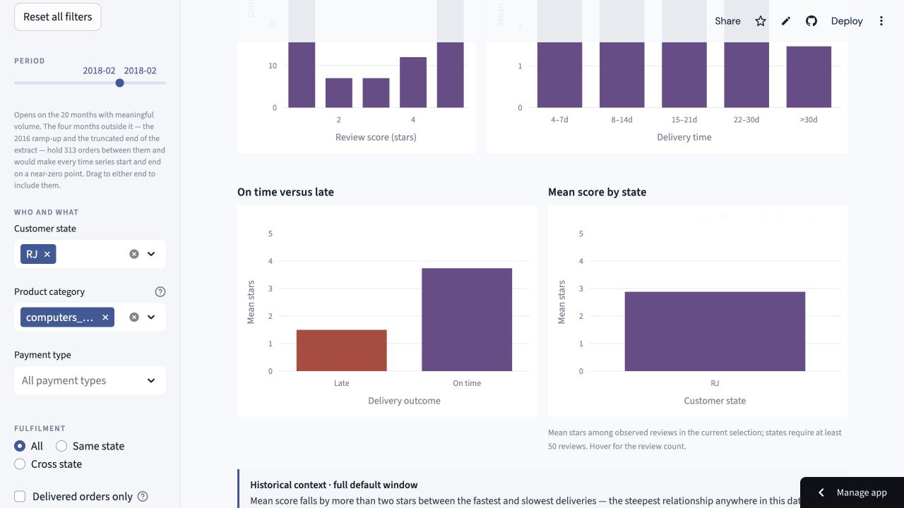

Zero-order months remain in count/sales trends; undefined or insufficient rates
remain gaps. The classification monthly ranking curve is explicitly distinguished
from fixed-threshold cards. Regression assets and forecast downloads are tied to
their verified deployment manifest. The
[verification record](../../deployment/deep_audit_verification.json) separates
online checks from the 77 local tests (76 passed, one environment-specific skip).

See the [dashboard guide](../../dashboard/README.md) for setup, prediction
semantics, evaluation sources and limitations.

## New order inputs and individual risk factors

Captured from the same Cloud URL on 3 November 2026. Both prediction tasks now
accept editable feature rows and bounded CSV batches. The new order ID does not
need to exist in the historical examples. The screenshot shows two supplied
delivery orders evaluated by the existing fitted deployment model.

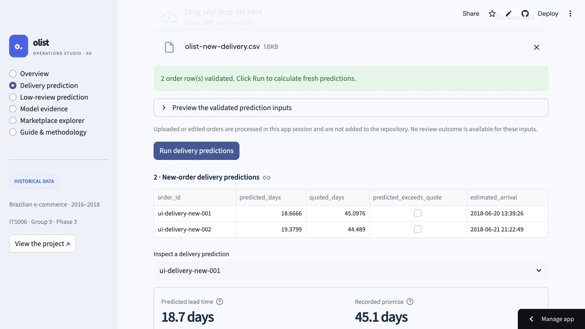

Classification now explains an individual score with signed decision-path
contributions. Users can switch between business groups and original features,
inspect recorded values, and select another scored row in a batch. The baseline
plus all contributions equals the raw risk score; this is not SHAP or a causal
effect. The screenshot shows the strict model's new-order score of 0.8896.

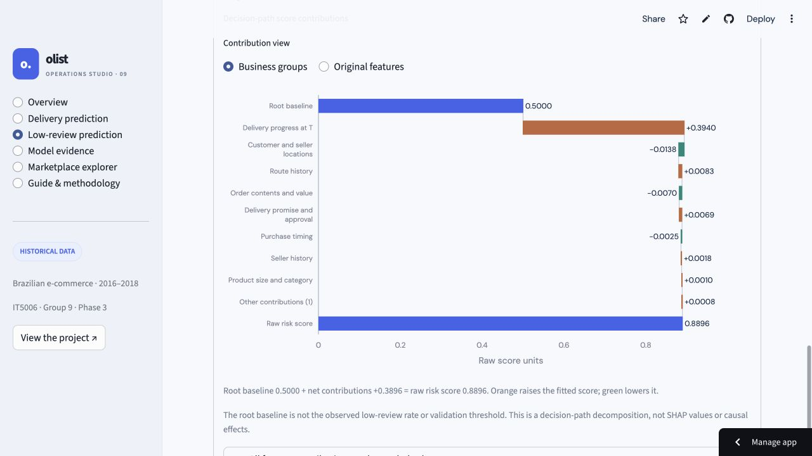

The [verification record](../../deployment/new_orders_verification.json) covers
the 136 dashboard checks (134 passed in the application runtime; two trusted
model checks passed separately in the compatible export environment), both
online classifiers, two-row CSV batches for both tasks, real downloads matching
local inference, historical explanations and state clearing. The 251 protected
original model/source/output/asset files remain unchanged.

## Delivery and review EDA, with compact references

Captured from the same Cloud URL on 3 November 2026. The Guide now keeps only
essential data, code, feature/model definitions and deployment references in a
collapsed section. Internal audit/todo buttons and the raw manifest display are
removed from the interface; the repository materials are retained.

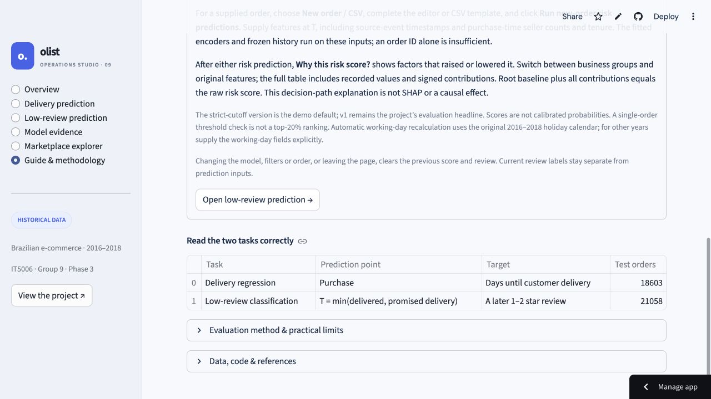

Delivery replaces the clipped duration histogram with exact elapsed-day buckets
and a separate complete tail. In the default selection, P90 is 23.1 days, P95 is
29.2 days, and the >60-day bucket contains all 303 orders. The distance-only curve
is replaced by a selector comparing median and P90 for distance, freight share,
item count and seller count.

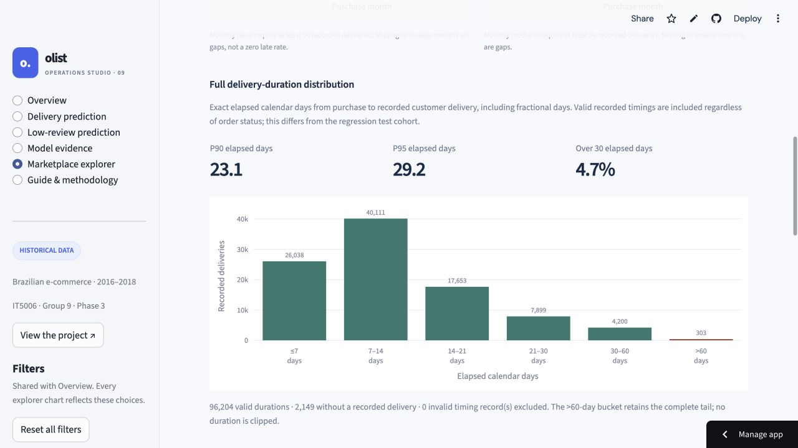

Reviews focuses on the observed 1–2 star share, including review coverage,
delivery timing and order attributes. Horizontal dots show group proportions
with 95% Wilson intervals; smaller groups retain counts but have no plotted
estimate. Reviewed orders without recorded delivery remain separate. These are
descriptive associations and use a different cohort from the classifier's
T-eligible evaluation.

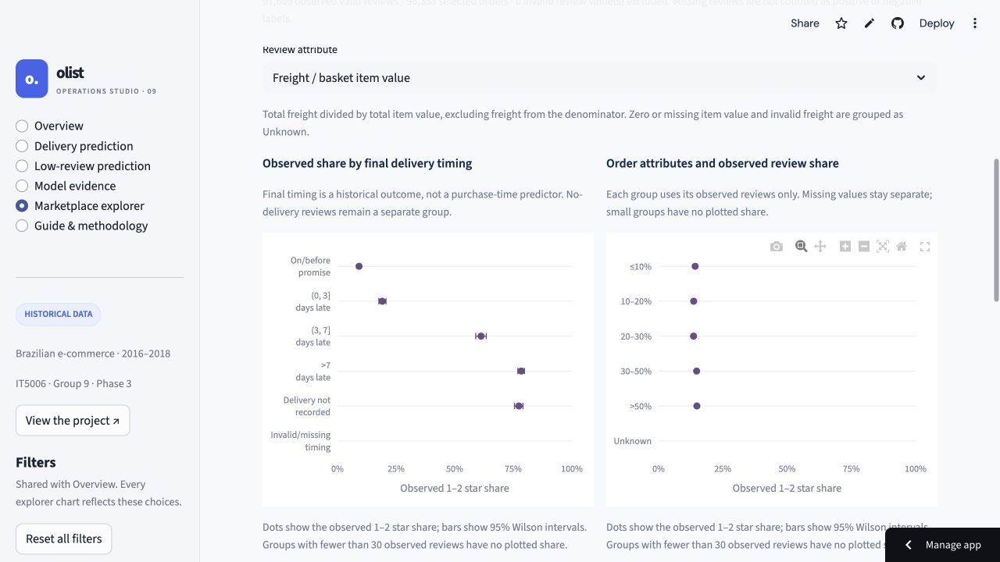

The [verification record](../../deployment/focused_eda_verification.json) covers
164 dashboard checks (162 passed; two unchanged trusted-model checks remain
environment-specific skips), final layout checks, online attribute switches and
a shared RJ-filter check against independently calculated counts and percentiles.
The committed extract and 251 protected original model/source/output files are
unchanged. No model training, feature selection or report/slide edits were made.
