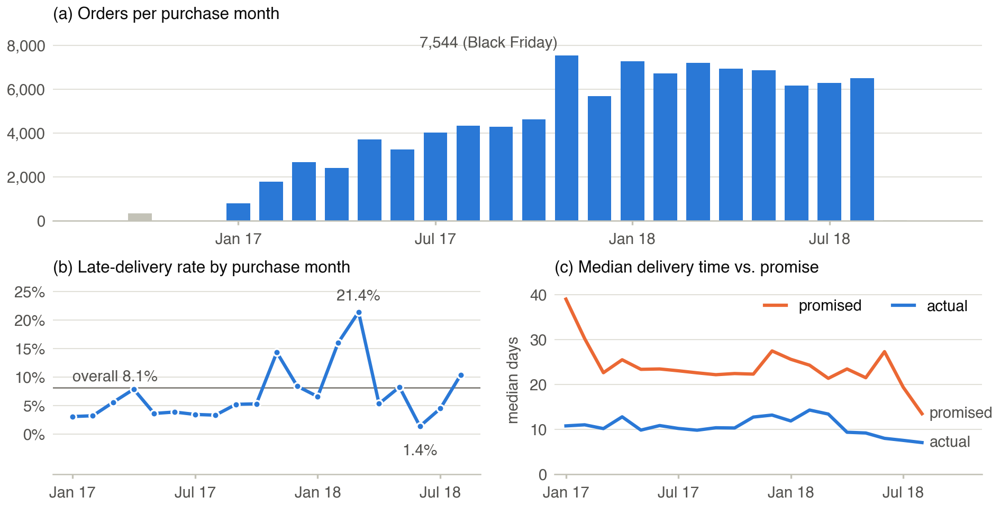
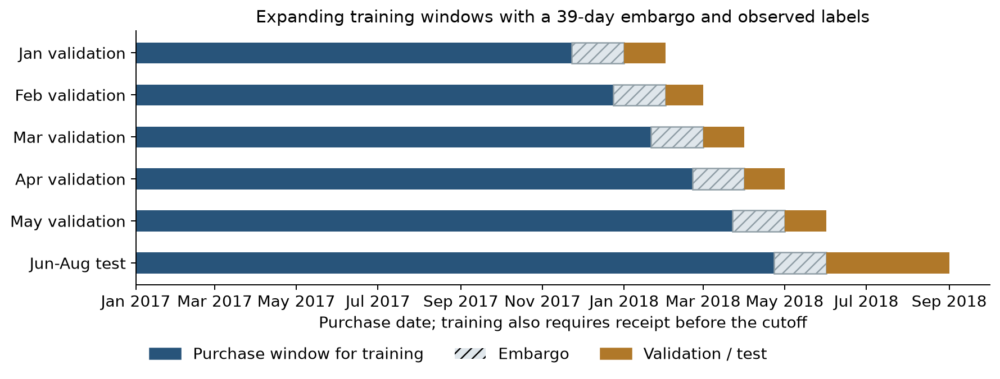
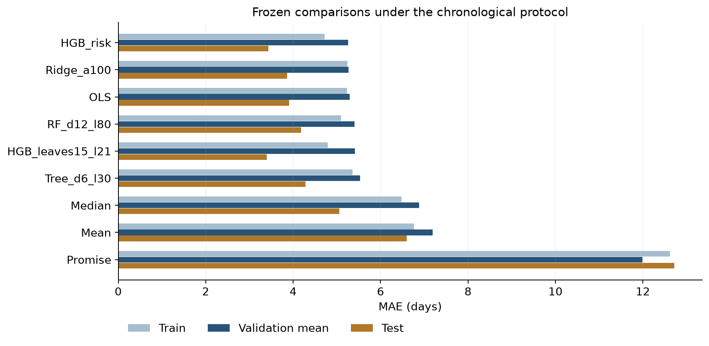
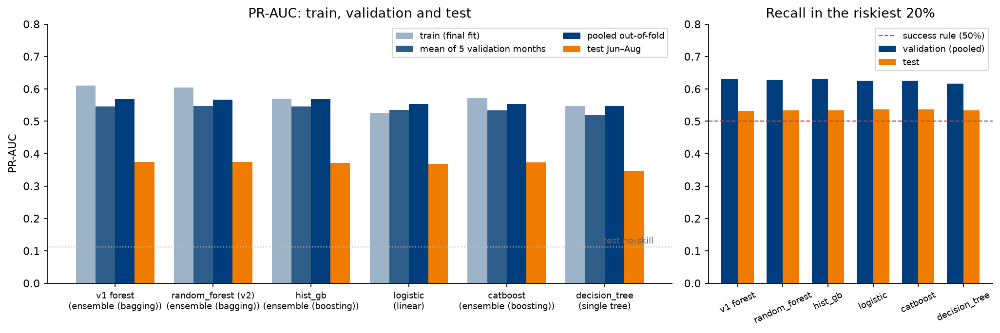
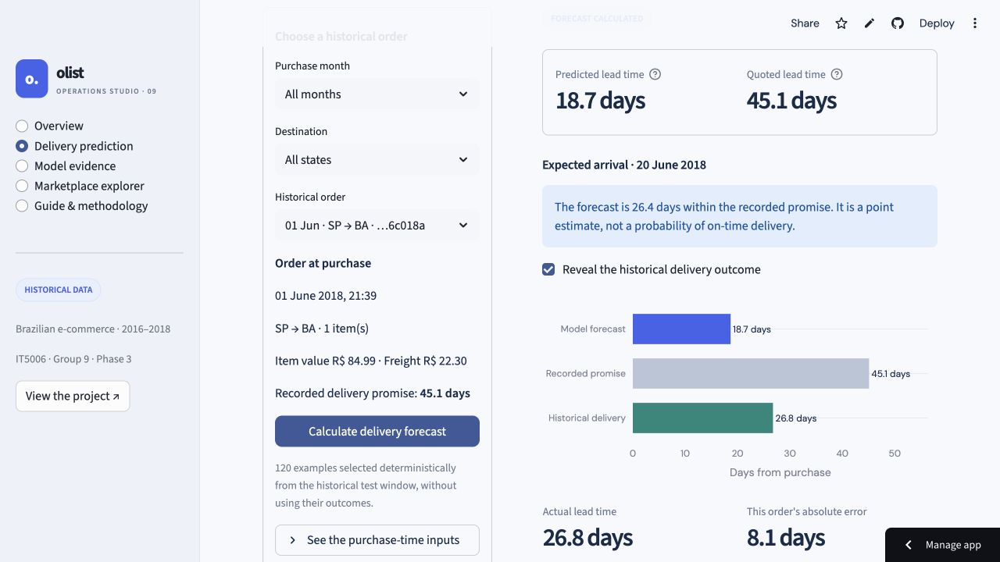

# Executive summary

## Project overview

Olist is a Brazilian e-commerce marketplace that connects small sellers to customers across the country. Its delivery promises are usually generous (median promise 23 days against a median delivery of 10 days) but are missed in bad months (up to 21% of orders late), and late orders are far more likely to receive a 1–2 star review (Section 2.2). Using the Olist public dataset of 99,441 orders (2016–2018), we built an end-to-end pipeline covering data preparation, exploratory analysis, feature engineering, chronological model evaluation and deployment for two prediction tasks that serve two teams at two decision points: a **regression** model that forecasts delivery lead time at purchase for operations, and a **classification** model that flags orders at risk of a low review just before the review survey is sent, for the customer-experience team.

## Key findings

- **Delivery lead-time regression (operations, at purchase).** A histogram gradient-boosting model (HGB) with a past-only slow-delivery risk feature predicts purchase-to-receipt days. On 18,603 orders purchased in June–August 2018 it achieves **MAE 3.43 days** (RMSE 5.09, R² 0.23), 32% below the training-median reference (5.06) and 11% below Ridge regression (3.86), the strongest simple model. Its training–validation gap is no larger than that of a baseline that cannot overfit. Both pre-set success criteria are met.
- **Low-review risk classification (customer experience, at the survey trigger).** A random forest scores each order at T = min(delivered, promised date). On 21,058 orders in June–August 2018 it reaches **PR-AUC 0.375** (3.3 × the 11.3% no-skill rate) and its riskiest 20% of orders contain **53.2%** of low reviews, against 41% for the best simple rule. Delivery status at T is the main driver; the second is basket size: orders with two or more items are about three times as likely to receive a low review even when delivered on time. Both pre-set success criteria are met.

In response to Phase 2 feedback, both tasks are now evaluated **chronologically only**; no random-split result is used as evidence: five expanding monthly validation windows (January–May 2018) select models, and a June–August 2018 window, locked by order-ID hash, is scored once after selection is frozen. All model families are compared on identical inputs and preprocessing, training scores are reported beside validation and test scores, and the complete feature catalogues and search ranges are in Appendix B. A later quality audit found a small number of labels and features that were not yet available at their cut-off; a separately versioned **strict cut-off rerun** removed them and changed classification test PR-AUC by only −0.001 (Section 3.1).

Linear models are close behind the ensembles in both tasks (≤ 0.43 days and ≤ 0.006 PR-AUC). In regression, Ridge was better than the selected model in four of five validation months; the selected model won the pre-set rule by 0.011 days and was clearly better on the locked test, so it is deployed with Ridge as the documented fallback (Section 3.3). Stacking did not clear its pre-set gain rule in either task, and resampling (undersampling, oversampling, SMOTE) never improved ranking. The regression model is deployed in a Streamlit application that forecasts held-out historical orders (Section 4). We recommend route-specific promise review, a top-20% daily outreach queue with an A/B test, and monthly drift monitoring (Section 5).

## Main contributions

- **Chronological re-evaluation of both tasks.** Phase 2's random splits were replaced by five expanding monthly validation windows and a hash-locked June–August 2018 test window scored once per frozen selection, with explicit label-availability rules and a strict cut-off rerun that quantified the residual leakage (−0.001 test PR-AUC).
- **Matched, evidence-based model comparison.** A small set of families chosen from the literature (linear, single tree, bagging, boosting, one stack) was compared on identical features and preprocessing, with training, validation and test scores reported side by side and every search range in Appendix B.
- **Operational framing.** Each model has a defined stakeholder, prediction point and success criterion fixed before testing; the classifier is judged at the CX team's 20% contact capacity, the regression model against Olist's own promise.
- **Deployed application.** The regression model runs in the *Olist Operations Studio* Streamlit app, which forecasts held-out historical orders and shows the evidence for both models (Section 4).
- **Actionable insights.** Geography drives delivery time; lateness and then basket size drive low reviews; route-specific promises and a top-20% outreach queue reach about 300 more unhappy customers than the best simple rule (Section 2.2).

# 1. Introduction and background

## 1.1 Problem statement

E-commerce platforms trade attractive delivery promises against reliable fulfilment, and delivery performance is one of the strongest drivers of online ratings (Section 1.2). Olist's public data (99,441 orders, September 2016–October 2018) records the promise, every fulfilment timestamp and the customer's review, which makes both sides of this trade-off measurable. Table 1 defines the two problems completely, which the Phase 1 feedback found under-specified.

::: Table 1. Problem definitions: target, grain, prediction point, stakeholder and success criteria

| | Regression: delivery lead time | Classification: low-review risk |
|---|---|---|
| Question | How many days will pass between purchase and receipt? | Will this order receive a 1–2 star review? |
| Target | (customer receipt − purchase timestamp) in fractional days | `is_low_review` = 1 if score ≤ 2 (14.2% overall; 11.3% in test) |
| Grain | One row per completed order | One row per reviewed order (earliest review) |
| Prediction point | Purchase timestamp; only information known at checkout | T = min(delivered date, promised date), the survey trigger; only information known at T |
| Population | 96,203 completed deliveries purchased Jan 2017–Aug 2018 | 97,187 reviewed orders with T in Jan 2017–Aug 2018, review answered after T |
| Stakeholder and decision | Operations / fulfilment planners and customer service: flag routes and orders likely to be slow, set expectations, check carrier capacity | Customer-experience (CX) team: contact the riskiest 20% of each day's orders before the customer answers the survey (proactive update, service recovery, seller review) |
| Primary metric (fixed before modelling) | MAE in days | PR-AUC (average precision) |
| Success criteria (fixed before the chronological test) | Test MAE ≥ 5% below the training-median reference **and** below the delivery promise | Test PR-AUC ≥ 2 × the test positive rate **and** the riskiest 20% (the CX capacity) contains ≥ 50% of low reviews |

The two tasks use different prediction points on purpose. A lead-time forecast is useful only before fulfilment starts, so it may use nothing recorded after checkout. Review risk is acted on just before the survey is sent, when the delivery outcome (delivered or not, how late) is already known; using it is legitimate because it is observed at T, while the review itself and anything after T are excluded.

## 1.2 Literature review summary

The Phase 1 review concentrated on algorithms. This update first reviews what e-commerce research has found about the two problems (Sections 1.2.1–1.2.2), then uses that evidence and the modelling literature to narrow the model families, features and metrics for each problem before any result was seen (Sections 1.2.3–1.2.5).

### 1.2.1 Delivery performance, satisfaction and repurchase

**Lateness lowers ratings, and much more than earliness raises them.** Using Bayesian ordinal models of online review ratings, Ravula (2023) finds that late deliveries receive much lower ratings than on-time deliveries, while early deliveries are rated only slightly higher than on-time ones: the response is asymmetric. Ratings given longer after a late delivery are less negative, so the penalty fades with temporal distance. Akturk et al. (2022), drawing on expectation-disconfirmation theory, find that longer processing and delivery times both lower ratings, that ratings are curvilinear in days early or late, and that the late-delivery penalty is larger for expensive orders and weaker when freight cost is high. On more than 11 million purchases, Nozari and Alavi (2026) estimate causal effects of about −0.4 stars for late delivery and, surprisingly, −0.2 stars for early delivery in most categories: arriving earlier than promised does not reliably please customers.

**Delivery speed affects ratings, purchases and sales.** On over 15 million Tmall orders, Deshpande and Pendem (2023) show that customers who were promised no particular speed still rate deliveries lower when they take more than two days (an implicit two-day expectation), and that poor logistics ratings reduce later customers' purchase probability; cutting all three-day deliveries to two days would raise third-party sellers' daily sales by an estimated 13.3%. Vakulenko et al. (2019) find, in a survey of Swedish online shoppers, that the last-mile delivery experience mediates the link between the online shopping experience and satisfaction.

**Late delivery reduces repeat purchase.** Rao et al. (2011) show that after an order-fulfilment delay, previously loyal customers order less often and place smaller orders. Amorim et al. (2025) find that a failed grocery order delays the next order by 7.2% on average.

**Promises cut both ways.** In a field experiment that varied the displayed delivery estimate while actual shipping was unchanged, Cui et al. (2024) find that faster promises raise sales and profit but also raise returns and lower retention, because over-promising creates waits longer than expected.

**Implications and gap.** The literature agrees that satisfaction depends on delivery relative to the expectation the promise creates, with a steep penalty for lateness and little or no reward for earliness. Olist's long promises (Section 2.2) make most orders "early", so lateness, not raw speed, should be the key classification signal, and the review should be predicted once delivery status is known. These studies estimate average effects; few build order-level early-warning tools that operations or customer-experience teams can act on, which is the gap our classifier addresses.

### 1.2.2 What drives delivery time

On JD.com data, Salari et al. (2022) find that the two main sources of delivery-time variation are the order time (orders before the daily cut-off get same-day handling) and the dispatching warehouse, followed by product type and warehouse backlog. Delivery times are asymmetric and multimodal, and planning on the full distribution rather than a point estimate cut promise costs by 7.2–28.8%. Deshpande and Pendem (2023) show that delivery speed varies with the seller and the logistics service level. We found no peer-reviewed study of Olist lead-time drivers. These findings imply that, for Olist, the dispatch location (seller geography and distance to the customer), order timing and the seller should be the main predictors, and that errors will have a long right tail that a point forecast cannot fully capture.

### 1.2.3 Modelling approaches and the families chosen

**Evidence from comparisons.** In Kandula et al.'s (2021) delivery-success study the models performed almost identically: with a cost-sensitive loss, AUC was 79.0 for the random forest, 79.0 for XGBoost, 76.7 for AdaBoost-logistic and 77.3 for a neural network. XGBoost was chosen for speed and size (4.4 ms prediction and a 0.6 MB model against 2.6 s and 712 MB for the forest), not accuracy. That trade-off does not apply to Olist, which is small enough that computation is not a constraint, so it is no reason to prefer XGBoost here. For delivery-time distributions, Salari et al. (2022) report CRPS 6.04 for quantile regression forests against 6.79 for a single regression tree and 6.84 for linear quantile regression: the forest won by capturing non-linear operational effects and the asymmetric distribution. Zaghloul et al. (2024) report that a random forest (92% accuracy) outperformed SVM and multilayer-perceptron models for satisfaction prediction, with delivery time a key driver. Across typical tabular datasets, tree ensembles outperform deep networks (Grinsztajn et al., 2022). The consistent pattern is that ensembles beat single trees by reducing variance, but their margin over a well-specified linear model can be small when a few strong features dominate.

**Class imbalance.** Kandula et al. (2021) preferred a cost-sensitive weighted loss to resampling, and van den Goorbergh et al. (2022) show that resampling corrections distort predicted probabilities without improving discrimination. Zaghloul et al. (2024) reported random oversampling as best, but under a random split. We therefore planned weights versus no correction as the main comparison and resampling as a check, judged by both ranking and calibration.

::: Table 2. Model families narrowed by problem using the literature

| Family | Lead-time regression | Low-review classification | Reason |
|---|---|---|---|
| Linear (OLS / Ridge; logistic regression) | Yes, baseline | Yes, baseline | Simplest interpretable reference; tests whether a few strong features suffice |
| Single decision tree | Yes, baseline | Yes, baseline | Non-linear but high-variance reference (Salari et al., 2022) |
| Random forest (bagging) | Yes | Yes | Best or tied-best in Kandula et al. (2021), Salari et al. (2022) and Zaghloul et al. (2024) |
| Gradient boosting (HGB; CatBoost for categoricals) | Yes (absolute-error loss to match MAE) | Yes | Tied with the forest in Kandula et al. (2021); strong on tabular data |
| Convex stacking | One stack | One stack | Kept only if it beats the best single model by a pre-set margin |
| Neural networks, graph models (e.g. dual-graph multitask) | No | No | No accuracy gain on tabular data; Olist is too small and sparse for graph methods |
| Quantile / distributional forests | Future work | n/a | Valuable for promise setting (Salari et al., 2022), but outside the point-forecast scope |

### 1.2.4 Feature engineering applicable to Olist

Table 3 links each feature family in the literature to the model that used it, how it is built from Olist columns, and the problem that uses it. Not every feature transfers: warehouse backlog and counts of nearby amenities (Kandula et al., 2021) have no Olist equivalent, and the delivery durations used by Zaghloul et al. (2024) are known only after purchase, so they are allowed only in the classification task, capped at T.

::: Table 3. Literature features and their Olist construction

| Literature feature (paper, model) | Olist construction | Used in |
|---|---|---|
| Dispatch location and distance (Salari et al., 2022, QRF) | Haversine distance between seller and customer zip-prefix coordinates; same state / city; seller and customer state and region | Both |
| Order timing (Salari et al., 2022, QRF) | Purchase hour, weekday and month from `order_purchase_timestamp` | Both (tested by ablation) |
| Promised delivery (Cui et al., 2024; Deshpande & Pendem, 2023) | Promised days = estimated delivery date − purchase time; days to shipping limit | Both |
| Delivery time and lateness vs promise (Akturk et al., 2022; Zaghloul et al., 2024, RF) | Delivered by T, days late, carrier handover and transit days, all capped at T | Classification |
| Order value, freight and freight ratio (Akturk et al., 2022; Zaghloul et al., 2024, RF) | Sums of item price and freight; freight / price; payment value and instalments | Both (payment: classification only) |
| Product and basket attributes (Salari et al., 2022, product type) | Weight, volume, category, number of items, distinct products and sellers | Both |
| Seller performance (Deshpande & Pendem, 2023) | Seller's past late rate, delivery days and low-review rate from earlier training-fold outcomes | Classification (history); regression (past-only slow-delivery risk) |

### 1.2.5 Evaluation metrics, fixed before modelling

Metrics must be fixed before models are compared; otherwise the metric can be chosen to favour a model. For **regression**, MAE is primary: it is in days, interpretable for planners and robust to the long tail; RMSE (sensitive to large errors), R² and the share of orders within ±3 days are secondary. For **classification**, PR-AUC is primary: the positive class is rare (11–15%) and the CX team ranks orders, so a threshold-free measure of positive-class ranking fits better than accuracy or ROC-AUC, which the majority class inflates. Recall and precision in the top 20% (the operating capacity) are the decision metrics; ROC-AUC and the Brier score (probability quality; van den Goorbergh et al., 2022) are secondary. When metrics disagree, the primary metric decides.

### 1.2.6 Synthesis and how it guided the project

The literature shows that delivery relative to the promise is the main lever on satisfaction and repurchase, that geography, timing and the seller drive delivery time, and that tree ensembles usually, but narrowly, beat linear models on such tabular data. It also shows recurring weaknesses: random splits on temporal data, resampling that harms calibration, and little use of operational baselines. We therefore evaluated chronologically, compared a small set of families on identical inputs against operational baselines (the promise and the "not delivered by T" rule), tested imbalance corrections against calibration, and fixed MAE and PR-AUC as primary metrics in advance.

## 1.3 Project objectives

1. Predict each completed order's purchase-to-receipt time at checkout more accurately than Olist's delivery promise and a training-median reference (success: test MAE at least 5% below the median reference and below the promise).
2. Rank orders at the survey trigger T so that the CX team's 20% daily contact capacity reaches at least half of the customers who will leave a 1–2 star review (success: recall in the top 20% ≥ 50% and PR-AUC ≥ 2 × the positive rate).
3. Evaluate both models on later, unseen months with no use of future information, as the Phase 2 feedback required, and compare model families on identical inputs.
4. Identify the drivers of delivery time and review risk, deploy a working application, and translate the results into business recommendations.

## 1.4 Corrections from Phase 1 and Phase 2 feedback

Table 4 lists every correction requested by the evaluators and where it is addressed in this report. The submitted Phase 1 and Phase 2 PDFs are kept unchanged in the repository as historical records.

::: Table 4. Evaluator feedback and how it was addressed

| Phase | Feedback | Response in this report |
|---|---|---|
| 1 | Existing-works review should report substantive e-commerce findings (does late or early delivery change satisfaction, by how much, does it affect repurchase), not algorithms | Section 1.2.1 reviews findings on delivery performance, promises, ratings and repurchase; Section 1.2.2 on drivers of delivery time |
| 1 | Model comparison is shallow; use the literature to narrow the model set per problem and justify imbalance handling | Section 1.2.3 reports the performance of the alternative models, explains why the winners won, and Table 2 narrows the families per problem (and excludes, e.g., graph models) |
| 1 | Feature engineering must say which features fed which model, and how each is built from Olist | Table 3 maps each literature feature to its paper and model, the Olist columns used to build it, and the problem that uses it |
| 1 | Metrics must be chosen per problem before modelling, with one primary criterion | Section 1.2.5 and Table 1: MAE and PR-AUC are primary, fixed before any chronological result; other metrics are secondary |
| 1 | Conclusion should synthesise and set next steps | Section 1.2.6 |
| 1 | Every EDA claim needs a figure; list leakage roles by column; consistent sub-figure labels | Section 2.2: each claim cites Figure 1–2 sub-panels; Table 5 lists every column by availability role |
| 1 | Target, grain, stakeholder and prediction point not fully specified | Section 1.1, Table 1 |
| 1 | One coherent report; references at the end; respect page limit | Single integrated structure; references before the appendices |
| 1 | Update the dashboard as models develop | Section 4: the app now includes a live regression predictor and model evidence |
| 2 | Explicit regression success criterion; define the classification operating target | Table 1 (fixed before the chronological test); both met (Section 3.2) |
| 2 | Use time-ordered splits for both tasks; re-check calendar importance | Section 2.4; calendar importance is near zero chronologically (Section 3.3) |
| 2 | Compare Tree, RF and HGB on the same features and preprocessing | Section 2.3: every family shares one feature set and preprocessor; feature changes are separate ablations |
| 2 | Report classification search ranges, the 12 Ridge and 6 RF candidates, and the single-tree choice | Section 2.3 and Appendix B (B4, B6, B7) |
| 2 | Report training scores beside CV, validation and test | Tables 7, 8 and 9 |
| 2 | Keep the regression test untouched until selection is final | Test IDs hashed before fitting; selection frozen before one assessment (Section 2.4) |
| 2 | Section 3.3 cited a non-existent "Figure 2" | That reference should have read Figure B5a (Phase 2 appendix); all cross-references in this report have been rechecked |
| 2 | Full feature catalogue and model specifications inside the appendix | Appendix B embeds every feature, preprocessing step, specification and search range |
| 2 (clarification) | Chronological split must be the primary evaluation, not a supplement; do not reuse the test set | Both tasks redone chronologically; later test scorings are labelled secondary |
| 3 (presentation) | A random split is not valid for this temporal data | All random-split results have been removed; every result in this report comes from the chronological protocol |
| 3 (presentation) | Show train, validation and test for regression, and how we know the model is not overfitting | Section 3.1 and Table 8: training and validation error by month against a baseline that cannot overfit, the complexity curve, and the test |
| 3 (presentation) | Explain why boosting with the added risk feature was chosen over Ridge | Section 3.3 and Table 11: the evidence for and against each, the pre-set rule, and Ridge as the fallback |
| 3 (presentation) | Highlight the second most important classification driver besides delivery status | Section 3.3 and Table 12: basket size (number of items) |

# 2. Methodology

## 2.1 Data preprocessing approach

**Data.** The nine Olist course tables form a star around `orders`: `order_items` (1.14 rows per order) links products and sellers, `payments` (1.04) and `reviews` (1.01) join on `order_id`, and customers and sellers reach `geolocation` through their zip-code prefix (Appendix A, Table A1). One-to-many tables are aggregated to one row per order before joining, so no join inflates the order count.

**Cleaning.** Geolocation is reduced to one median coordinate per zip prefix after removing 29 coordinates outside Brazil; distance is the haversine distance between seller and customer prefixes. 775 orders without line items and the review comment fields (58.7–88.3% missing) are excluded. The year 2016 (303 orders) is too sparse to train on. Long but valid delivery times are kept (289 deliveries over 60 days), because they are exactly the cases operations care about. Remaining missing values (distance 0.5%, category 1.4%, weight 0.02%) are imputed inside each training fold with missing-value flags, never deleted. The lateness flag compares calendar days: the promise is stored at 00:00, so a timestamp comparison wrongly marked 1,265 same-day deliveries as late; with this fix the late rate is 6.7% rather than the 8.1% reported in Phase 1.

**Leakage roles.** Preprocessing fitted on future or test rows overstates performance (Kapoor & Narayanan, 2023), so every source column is assigned one availability role (Table 5); each task may use only the columns available at its prediction point. Seller and route history features (past late rate, past low-review rate, past delivery days) are computed inside each model pipeline from training-fold outcomes that were known before the fold's cut-off, as of each order's purchase time.

::: Table 5. Source columns by availability role (both tasks)

| Role | Columns | Regression | Classification |
|---|---|---|---|
| Identifiers (never features) | `order_id`, `customer_id`, `customer_unique_id`, `review_id`, `product_id`; `seller_id` only via smoothed history | excluded | excluded (seller via target encoding) |
| Known at purchase | `order_purchase_timestamp`, `order_estimated_delivery_date`, item `price`, `freight_value`, `shipping_limit_date`, product weight / dimensions / category / photos, customer and seller zip, city, state, geolocation | used | used |
| Known shortly after purchase | `order_approved_at`, `payment_type`, `payment_installments`, `payment_value`, `payment_sequential` | not used | used |
| Fulfilment events (known when they happen) | `order_delivered_carrier_date`, `order_delivered_customer_date` | target only | used only if at or before T (capped at T) |
| Post-outcome (never features) | `order_status` (final), `review_score`, `review_comment_title`, `review_comment_message`, `review_creation_date`, `review_answer_timestamp` | excluded | target / label timing only |

## 2.2 Exploratory data analysis highlights

**Volume and delivery reliability drift over time.** Monthly orders grew ninefold from January 2017 to the November 2017 Black Friday peak of 7,544 and then plateaued at 6,200–7,300 (Figure 1a). The late-delivery rate is far less stable: 1.4% to 21.4% by month (Figure 1b). Promises are long (median 23 days) relative to actual delivery (median 10 days), and the late spikes of November 2017 and February–March 2018 occurred when delivery slowed to 13–14 days while promises did not lengthen (Figure 1c). This instability is why a random split is unsafe: a random split mixes these regimes into training and test.

{92}

**Demand timing.** Orders peak on Monday (16% of orders) and fall at weekends (11–12%), and within the day they are high from 10:00 to 22:00 with a plateau between 11:00 and 16:00 (Figure 2a). Phase 1 described an evening peak; the hourly counts show a broad daytime plateau instead.

**Delivery against promise drives low reviews.** Among delivered orders, low (1–2 star) reviews are 9–10% when the parcel arrives a week or more early, 12% when it arrives on the promised day, 49% when it is 1–7 days late and about 80% when it is more than a week late (Figure 2b). Mean scores fall from 4.32 to 1.67 stars. Earliness gives little extra satisfaction beyond being on time, but lateness is punished steeply; orders that were never delivered have a 77% low-review rate. No purchase-time variable has a Spearman correlation stronger than −0.10 with the review score (Phase 1), so review risk is only predictable once delivery status is known, which motivates the prediction point T.

**Lead time is right-skewed and driven by geography.** Purchase-to-receipt time has median 10.2 days and 90th percentile 23.0 days, with a long tail (Figure 2c); MAE, which is robust to this tail, is therefore the primary regression metric, and RMSE is reported for large errors. Median lead time rises from 5.1 to 13.0 days across distance quintiles for same-state orders and from 8.1 to 15.7 days for cross-state orders (Figure 2d); the Spearman correlation between distance and lead time is 0.54. Because 60% of sellers are in São Paulo state, most parcels leave the south-east whatever the destination.

{100}

## 2.3 Model architecture

Both tasks share the same model families, chosen in Section 1.2.3 (Table 2), so that complexity is added step by step from the simplest baseline.

- **Linear models.** OLS and Ridge regression predict ŷ = β₀ + Σⱼ βⱼxⱼ; Ridge minimises Σᵢ(yᵢ − ŷᵢ)² + α Σⱼ βⱼ² to shrink unstable coefficients. Logistic regression models the low-review probability as p = 1 / (1 + e^−(β₀ + Σⱼ βⱼxⱼ)) with an L2 penalty set by C.
- **Single decision tree.** Recursive binary splits that minimise squared error (regression) or Gini impurity (classification); depth and minimum leaf size control its variance.
- **Random forest (bagging).** The average of B trees, each grown on a bootstrap sample with a random subset of features at every split, which decorrelates the trees and reduces variance.
- **Gradient boosting (HGB, CatBoost).** Trees are added sequentially, Fₘ(x) = Fₘ₋₁(x) + ν·hₘ(x), each fitted to the gradient of the loss; the regression HGB uses absolute-error loss to match MAE. HGB bins features and handles missing values natively; CatBoost uses ordered target statistics for categorical features.
- **Convex stack.** ŷ = Σₖ wₖ ŷₖ over a linear model, a forest and HGB, with wₖ ≥ 0, Σₖ wₖ = 1 and no intercept.

**Pipeline.** Every model is one scikit-learn `Pipeline` of three steps refitted inside every fold: (1) a history step that attaches seller and route statistics computed only from training-fold outcomes known before the cut-off; (2) a preprocessor per model kind (median imputation with missing-value flags; log transforms and standardisation for linear models; one-hot encoding for low-cardinality and cross-fitted target encoding for high-cardinality categoricals; native categoricals for HGB and CatBoost); (3) the estimator, with its class-imbalance treatment. Validation and test rows only pass through `transform` and `predict`.

**Features.** Regression uses 39 purchase-time fields in six groups (promise, geography, order, product, seller, calendar), plus a past-only slow-delivery risk score in the selected model (41 fields). Classification uses 51 features in nine groups (order, product, geography, calendar, promise, payment, delivery status at T, seller history, route history). Appendix B lists every field with its definition and source.

**Matched comparison.** Within each task every family receives the same features from the same history step, so no imputer, encoder, history table or resampler sees validation or test rows and differences between families are not confounded with input changes. Feature changes are tested separately as ablations on a fixed model, so gains from complexity are not confused with gains from features. The selected regression model combines one such feature, the past-only slow-order risk score, with HGB; Section 3.3 discusses what this means for its comparison with Ridge.

**Families and search.** Following Table 2, each task compares a linear model, a single tree and tree ensembles (bagging and boosting); Table 6 summarises the search. Regression enumerated 23 configurations before the first fit (115 fold fits). Classification used random search (seed 5006) over the Phase 2 ranges, scoring every candidate on all five folds; Part B widened the forest and HGB search with a two-stage screen (21 and 30 candidates). The full ranges, the original Phase 2 12 Ridge and 6 RF candidates, and how the single tree was chosen are in Appendix B.

::: Table 6. Model families and hyperparameter search (full ranges in Appendix B)

| Task | Family | Search | Selected configuration |
|---|---|---|---|
| Regression | OLS / Ridge | OLS (1); Ridge α ∈ {1, 10, 100, 1000} (4) | Ridge α = 100 |
| Regression | Decision tree | depth {6, 10} × min leaf {30, 100} (4) | depth 6, leaf 30 |
| Regression | Random forest | depth {12, 20, None} × min leaf {30, 80}; 100 trees, max_features 0.7, max_samples 0.8 (6) | depth 12, leaf 80 |
| Regression | HGB (absolute-error loss) | max leaves {15, 31, 63, 127} × L2 {1, 10}; min leaf 30, 300 iterations, learning rate 0.05 (8) | 15 leaves, L2 1; + risk feature |
| Classification | Logistic | C ∈ {0.001 … 1000} (7) | C = 0.01, no class weight |
| Classification | Decision tree | depth 3–12, min leaf 20–200 (20 random) | depth 8, leaf 159, 2:1 weights |
| Classification | Random forest | 300–600 trees, depth 6–24, leaf 5–100, max_features 0.2–0.8 (6); Part B 21 screened | 302 trees, depth 14, leaf 80, max_features 0.63 |
| Classification | HGB | learning rate 0.02–0.2, 200–800 iterations, 15–63 leaves, leaf 20–300, L2 0.001–10 (30 screened) | rate 0.021, 21 leaves, leaf 139 |
| Classification | CatBoost | depth 4–8, rate 0.02–0.2, 300–1000 iterations, L2 1–30 (6) | depth 4, 1000 iterations, rate 0.032 |

## 2.4 Implementation details

### Chronological evaluation design

Both tasks use the same calendar break points so that their results are comparable (Figure 3). Five expanding-window folds validate on one month each from January to May 2018; each trains on all eligible orders from January 2017 up to that month's cut-off. The test window is June–August 2018, and the final model trains on everything eligible before 1 June 2018. Regression places an order at its purchase time; classification places it at T.

{85}

**Label availability.** A model "trained on 1 March" may only learn from outcomes known by 1 March. Regression enforces this with a 39-day embargo (the 99th percentile of 2017 delivery times) **and** requires every training delivery to be recorded before the cut-off; the second rule removes a further 43–133 orders per fold. Classification uses a 27-day gap on T (the 99th percentile of review-answer delay); the strict rerun in Section 3.1 adds explicit review-answer cut-offs.

**Selection.** The model with the best mean validation score over the five months is selected (lowest MAE; highest PR-AUC). Differences are judged month by month, because monthly positive rates range from 12% to 24% and May's regression labels are only 65% complete at selection time. Regression selection uses only validation outcomes observed before 1 June; we report this limitation instead of hiding it.

### Protecting the test window

Before any model is fitted, the test order IDs are hashed into a lock file. The test step refuses to run without a frozen selection file and refuses a different selection after the first evaluation. Each task's headline model was scored on the test window exactly once. Experiments added afterwards (Part B ablations, class-balancing study, stacking, strict rerun) are labelled **secondary**: they were decided on validation and their test scores never re-selected a model. The June–August orders had been seen in Phase 2, so all test results are retrospective chronological assessments rather than a new unseen sample.

### Class imbalance and ensembles

**Class imbalance.** Low reviews are about 15% of orders: imbalanced, but not extremely. Following van den Goorbergh et al. (2022) we compared no correction, balanced and 2:1 class weights, random undersampling, random oversampling and SMOTE for every classification family, with resampling applied only to the training rows inside the pipeline. The rule, fixed before the run, prefers lower Brier score in at least 4 of 5 months provided PR-AUC falls by no more than 0.005.

**Ensembles.** Each task tested one convex stack of a linear model, a forest and HGB (non-negative weights summing to one, no intercept), with weights learned on the last three months inside each fold's training window, never on the validation month. A stack is kept only if it beats the best single model by the pre-set rule (regression ≥ 1% lower MAE; classification +0.010 PR-AUC in at least 4 of 5 months).

**Tools and reproducibility.** Python 3.12 (regression) and 3.14 (classification) with pandas, NumPy, scikit-learn (1.7.2 and 1.9.1), CatBoost 1.2.10 and imbalanced-learn; seeds are fixed (regression 5006 for models and 33 for the historical stacking rerun; classification 5006). Every fold result is cached, so an interrupted run resumes, and source and data hashes are recorded with each run. Full runs take about 2.5 hours per task on 8 cores; 21 classification and further regression, stacking and dashboard unit tests check the fold boundaries, label cut-offs and leakage rules. The exact environments are pinned in the repository (Appendix B1).

# 3. Results and analysis

## 3.1 Experimental results

### Regression: delivery lead time

Table 7 and Figure 4 report every family on the same orders. The selected HGB_risk has the lowest mean validation MAE (5.26 days) and test MAE 3.43 days. It meets both success criteria: 32.1% below the training-median reference (5.06) and far below the promise (12.72).

::: Table 7. Regression results by family: train (final model, in-sample), validation (mean of 5 months ± SD) and test (June–August 2018, n = 18,603)

| Model | Train MAE | Val MAE (± SD) | Test MAE | Test RMSE | Test R² |
|---|---|---|---|---|---|
| **HGB_risk (selected)** | 4.72 | **5.26 ± 1.64** | **3.43** | 5.09 | 0.23 |
| HGB, no risk feature | 4.79 | 5.41 ± 2.05 | 3.40 | – | – |
| Ridge (α = 100) | 5.24 | 5.27 ± 1.25 | 3.86 | – | – |
| OLS | 5.23 | 5.29 ± 1.22 | 3.91 | – | – |
| Random forest | 5.09 | 5.40 ± 1.50 | 4.18 | – | – |
| Decision tree | 5.36 | 5.53 ± 1.50 | 4.28 | – | – |
| Convex stack (Ridge, RF, HGB) | – | 5.30 ± 1.29 | not fitted (discarded) | – | – |
| Training median | 6.48 | 6.88 | 5.06 | – | – |
| Delivery promise | 12.62 | 11.99 | 12.72 | – | – |

{80}

**Train, validation and test: is the model overfitting?** Each fold refits on its training window and scores the next month (Table 8). A training–validation gap alone does not show overfitting here, because months differ in difficulty: the training median, which cannot overfit, is 1.6–2.8 days worse on the disrupted January–March and better on the calm April–May. HGB_risk's mean gap (0.95 days) is no larger than the median's (1.00); Ridge's is 0.51. Three further checks agree. (1) Complexity was chosen on validation: from 15 to 127 HGB leaves, training MAE falls from 4.34 to 3.67 days while validation MAE rises from 5.41 to 5.48, so the smallest size was selected; the forest likewise preferred larger leaves and the tree the shallower depth. (2) The selected configuration is regularised (minimum leaf 30, L2 penalty, learning rate 0.05, absolute-error loss). (3) The test does not degrade: test MAE (3.43) is below in-sample training MAE (4.72), and the families keep their validation order on test except the plain HGB, which moves up (3.40).

::: Table 8. Regression training and validation MAE by fold (days): each fold trains on eligible orders before its validation month, less the 39-day embargo

| Validation month | Training orders | Median: train → validation | Ridge: train → validation | HGB_risk: train → validation |
|---|---|---|---|---|
| January 2018 | 34,246 | 5.24 → 6.81 | 4.22 → 5.43 | 3.85 → 5.51 |
| February | 42,450 | 5.80 → 8.56 | 4.72 → 6.41 | 4.26 → 6.55 |
| March | 47,940 | 5.86 → 8.58 | 4.76 → 6.53 | 4.31 → 6.85 |
| April | 54,882 | 6.05 → 5.40 | 4.89 → 4.02 | 4.44 → 4.59 |
| May | 62,130 | 6.44 → 5.07 | 5.23 → 3.95 | 4.71 → 2.80 |
| **Mean (gap)** | | 5.88 → 6.88 (+1.00) | 4.76 → 5.27 (+0.51) | 4.32 → 5.26 (+0.95) |
| **Final model → test (June–August)** | 68,916 | 6.48 → 5.06 | 5.24 → 3.86 | 4.72 → 3.43 |

**Why test MAE is lower than validation.** The test window had far fewer long deliveries: mean purchase-to-receipt time was 8.6 days against 13.7 in the final training data, and only 0.9% of test orders took over 30 days against 5.9% (Figure 1c shows the faster summer deliveries). Validation also includes the disrupted February and March. The test window is easier; the model is not better than its validation score suggests.

**Errors.** Errors concentrate where planning matters: cross-state orders have MAE 4.17 days against 2.34 within a state, and the 171 test orders over 30 days (0.9%) are underpredicted by 23–59 days and contribute 6.9% of total absolute error. Monthly test MAE is 3.70, 3.62 and 3.00 days for June, July and August, with a small over-prediction on average (0.7–1.4 days). Only 55.9% of orders fall within ±3 days, so forecasts are planning estimates, not guaranteed dates.

### Classification: low-review risk

The frozen v1 random forest was evaluated once: test PR-AUC 0.375 (95% CI 0.356–0.397), recall in the top 20% 0.532 (CI 0.514–0.551), precision 0.300, a lift of 2.66. Both criteria are met. Table 9 and Figure 5 compare all families on the same 21,058 orders.

::: Table 9. Classification results by family: train (final model, in-sample), validation (mean of 5 months) and test (June–August 2018, n = 21,058, 11.3% positive)

| Model | Train PR-AUC | Val PR-AUC | Test PR-AUC | Test ROC-AUC | Test Brier | Test recall top 20% |
|---|---|---|---|---|---|---|
| **Random forest v1 (headline)** | 0.610 | **0.5463** | **0.375** | 0.739 | 0.149 (0.090 calibrated) | **0.532** |
| Random forest v2 (no weights) | 0.604 | 0.5468 | 0.375 | 0.740 | 0.088 | 0.534 |
| HGB | 0.570 | 0.5458 | 0.372 | 0.741 | 0.161 | 0.534 |
| CatBoost | 0.572 | 0.5331 | 0.374 | 0.740 | 0.156 | 0.537 |
| Logistic regression | 0.526 | 0.5352 | 0.369 | 0.738 | 0.088 | 0.536 |
| Convex stack (not retained) | – | 0.5474 | 0.378 | 0.742 | 0.088 | 0.539 |
| Decision tree | 0.548 | 0.5190 | 0.347 | 0.728 | 0.163 | 0.534 |
| Rule: not delivered by T | – | 0.3832 | 0.210 | 0.628 | – | 0.406 |
| No skill | – | 0.1684 | 0.113 | – | – | 0.200 |

{100}

**Class imbalance.** Leaving the data unweighted was best for four of five families: ranking was unchanged (Δ PR-AUC −0.0004 to +0.0053) and Brier fell from 0.16–0.18 to 0.10, because balancing to 1:1 inflates the mean score to 0.40–0.45 against a true rate of 0.17. Random undersampling lost 0.003–0.022 PR-AUC by discarding three-quarters of the negatives, oversampling made the forest overfit (train 0.632 vs validation 0.542) and SMOTE lost 0.002–0.019 by interpolating one-hot and encoded categories into unrealistic orders (Appendix C). This matches van den Goorbergh et al. (2022): at moderate imbalance, corrections distort probabilities without improving ranking.

**Experiments and stacking.** Five new feature groups, two training windows and wider searches each moved validation PR-AUC by at most +0.0012, far below the +0.010 bar (Appendix C, Table C7). The stack gained +0.0007 in validation (3 of 5 months) and was not retained; its +0.0035 on test is a secondary observation. v1 therefore remains the headline model; the unweighted forest (v2) is an equivalent alternative that needs no calibrator.

### Strict cut-off rerun

A quality audit after the main run found that the classification split filtered rows by T only, so 73–92 training labels per fold (0.12–0.24%) were answered after their cut-off, 422 of 34,395 validation labels (1.2%) were answered after the 1 June selection date, and 79 orders had approval or carrier features derived from events after T. We reran the whole v1 selection under explicit rules: training and validation labels must be answered before their cut-offs, post-T events are set to missing, and a manifest fingerprinting the selection, thresholds, data and source code is frozen before test.

The leaks were real but immaterial (Figure 6). With the v1 forest fixed, the strict rules lower validation PR-AUC by 0.0018 (a fifth of the 0.010 bar, against a fold SD of 0.086). The reselection again chose the random forest with the same family ranking; its test PR-AUC is 0.374 (CI 0.355–0.396) and top-20% recall 0.535, a paired difference from v1 of −0.0012 (CI −0.0043 to +0.0018). The removed labels were not random: May labels answered after 1 June had a 21.6% low-review rate against 11.6%, a reminder that slow reviews are disproportionately unhappy. Regression already enforced strict label availability.

{95}

## 3.2 Performance metrics

Table 10 checks each model against the success criteria fixed before the chronological test. Both models meet both criteria; the classification criteria are also met by the strict cut-off reselection.

::: Table 10. Success criteria on the June–August 2018 test window (fixed before testing)

| Task | Criterion | Target | Achieved | Met |
|---|---|---|---|---|
| Regression (HGB_risk, n = 18,603) | Test MAE ≥ 5% below training-median reference (5.06 days) | ≤ 4.81 days | 3.43 days (−32.1%) | Yes |
| Regression | Test MAE below the delivery promise | < 12.72 days | 3.43 days (−73%) | Yes |
| Classification (v1 forest, n = 21,058) | PR-AUC ≥ 2 × test positive rate (11.3%) | ≥ 0.225 | 0.375 (95% CI 0.356–0.397) | Yes |
| Classification | Riskiest 20% contains ≥ 50% of low reviews | ≥ 50% | 53.2% (95% CI 51.4–55.1%) | Yes |
| Classification (strict reselection) | Same two criteria | ≥ 0.225; ≥ 50% | 0.374; 53.5% | Yes |

**Regression metrics.** Besides MAE, the selected model has RMSE 5.09 days and R² 0.23 on test, and 55.9% of orders fall within ±3 days. R² is modest because much of the variance comes from rare extreme delays that purchase-time information cannot foresee; MAE, the primary metric, is less sensitive to them. Monthly test MAE is stable (3.70, 3.62 and 3.00 days).

**Classification metrics.** At the 20% operating rule, precision is 0.300 (lift 2.66 over random contact) and ROC-AUC is 0.739. Recall by month is 52.3%, 49.2% and 57.4%, so July falls just short of the target, and ranking each day's orders separately gives about 1.5–6 points less recall than ranking the whole window. A probability threshold frozen in validation would flag only 14.9% of test orders because scores shift with the lower test positive rate, which is why the operating rule is a rank (top 20% of each batch) rather than a fixed threshold.

## 3.3 Comparative analysis

Across both tasks the same pattern holds: the ensembles win, but narrowly, because a few strong features carry most of the signal.

### Model families

**Regression: why HGB_risk and not Ridge.** Linear models are surprisingly competitive, and the evidence is mixed (Table 11). *For Ridge:* HGB_risk won the pre-set rule (lowest mean validation MAE) by only 0.011 days; Ridge was better in January–April and HGB_risk only in May, whose labels were 65% complete at selection, so without May Ridge ranks first; Ridge is also steadier and easier to explain. *For HGB_risk:* its gain has a mechanism. Absolute-error loss matches the MAE target, and the past-only slow-order risk score warns about the long tail that dominates the error, lowering HGB's error in each disrupted month (January–March) by 0.15–0.86 days. After the choice was frozen, the test separated the two clearly: 3.43 against 3.86 days, about 10 hours closer per order, and both HGB variants beat Ridge, so the gain is not an artefact of May. *Conclusion:* HGB_risk was chosen by the rule fixed in advance and confirmed, not chosen, by the test. Because the risk score was tested only on HGB, the comparison is not fully matched, so we treat the two as close alternatives: HGB_risk is deployed, Ridge is the fallback, and Ridge with the risk score is the first re-comparison on new data (Section 6.3).

::: Table 11. HGB_risk against Ridge: the evidence on each side (MAE in days)

| Evidence | HGB_risk | Ridge | Favours |
|---|---|---|---|
| Mean validation MAE, January–May (pre-set selection rule) | 5.260 | 5.270 | HGB_risk, by 0.011 |
| Validation months won | 1 (May) | 4 (January–April) | Ridge |
| Mean validation MAE, January–April only | 5.874 | 5.600 | Ridge |
| May validation MAE (labels 65% complete at selection) | 2.80 | 3.95 | HGB_risk |
| Monthly SD of validation MAE | 1.64 | 1.25 | Ridge |
| Test MAE, June–August (scored after the choice was frozen) | 3.43 | 3.86 | HGB_risk, 11% lower |
| Test R² / share within ±3 days | 0.23 / 55.9% | 0.10 / 50.9% | HGB_risk |
| Explanation | grouped importance | coefficients | Ridge |

The plain HGB has the worst monthly SD (2.05): it does well in calm months and badly in the disrupted February and March, which is the weakness the risk score addresses. The single tree is worst among learned models, as expected from its variance. Stacking reached 5.30 days, 0.7% worse than the best single model, so it was discarded and no test score was produced; rerunning all 14 Phase 2 combinations chronologically gave 5.37–6.05 days, none clearly better (Appendix C).

**Classification.** The ensembles lead logistic regression by about 0.011 PR-AUC in validation and 0.006 on test, and the single tree by about 0.03 in every month: averaging trees removes the variance of one tree, but the signal is dominated by a few strong, mostly monotone features (delivered by T, days late, number of items) that a linear model captures well. Bagging and boosting are tied. Train–validation gaps are small (+0.02 for the forest, negative for logistic regression), so overfitting is not the issue. The validation-to-test drop (0.55 → 0.37) appears in every family: about half is the lower test prevalence (relative to no skill the ratio is 3.24 × in validation and 3.33 × in test), and the rest is a real loss of separation because fewer test orders were late at T.

### What the models rely on

Grouped permutation importance was measured on May 2018 validation orders, never on test (Figure 7). The regression model relies on **geography** (MAE rises by 1.03 days when route features are shuffled), then the **promise** (0.15) and **calendar** (0.05); seller, product and order groups add nothing measurable. The classifier relies on **delivery status at T** (PR-AUC drop 0.288 when its nine features are shuffled together), then **basket size** (below) and **seller history** (0.012).

**The second driver of low reviews: basket size.** The order group is the classifier's second most important group (PR-AUC drop 0.060), and almost all of it is the number of items: 0.044 on its own, the largest single feature after delivered-by-T (0.052). In the training months (Table 12) the low-review rate rises from 13.4% for one item to 26.9% for two and 34.2% for three or more, and the gap remains among orders already delivered by T (7.6%, 23.4%, 31.1%), which are delivered on time just as often. Basket size is therefore a separate signal, not a proxy for lateness. A plausible explanation, which the data cannot confirm, is that items in larger orders arrive separately or incomplete under one recorded delivery; multi-seller orders are the extreme case (49.9% low reviews, 906 orders).

::: Table 12. Low-review rate by number of items (classification orders with T in January 2017–May 2018, n = 76,129)

| Items in order | Orders | Low-review rate | Low-review rate if delivered by T | Share delivered by T |
|---|---|---|---|---|
| 1 | 68,515 | 13.4% | 7.6% | 89.5% |
| 2 | 5,858 | 26.9% | 23.4% | 91.7% |
| 3 or more | 1,756 | 34.2% | 31.1% | 92.0% |

**Calendar under a chronological split (Phase 2 feedback).** Phase 2 ranked purchase calendar as the regression model's second most important group. Under the chronological protocol its importance is only 0.05 days; removing calendar features entirely improves validation MAE (5.35 vs 5.41 days), and absolute dates (year-month, elapsed days) make it worse (5.69). The classification calendar group drops to 0.000. The calendar effect was period-specific: month-level delivery regimes do not carry forward to later months.

{100}

These are measures of model reliance, not causal effects; for example, shuffling `order` slightly helps the regression model, which suggests those features add noise.

## 3.4 Ethical considerations

**Regional fairness.** Forecast error is not spread evenly. Within São Paulo state the regression MAE is 2.3 days, but orders from São Paulo to Bahia, Pernambuco and Pará have MAE of 6.6, 7.1 and 5.9 days, because remote North and Northeast routes are rarer and more variable. Customers in less-served regions therefore receive less reliable estimates. Any customer-facing use should show wider ranges on these routes and monitor error by region, rather than present one national accuracy figure.

**Who receives outreach.** The classifier relies on delivery status, so it mostly prioritises late orders. Customers who are unhappy with an on-time order (wrong or poor-quality product) are rarely flagged (test PR-AUC 0.20 for orders delivered by T against 0.64 for those not delivered). The queue should complement, not replace, normal service channels.

**Review integrity.** Outreach must aim to fix the customer's problem, not to influence the rating. Contacting customers to discourage, suppress or buy positive reviews would mislead other shoppers and may breach consumer-protection rules; contact scripts should be factual (shipping updates, refunds, replacements) and outcomes should be measured by resolution as well as rating.

**Seller fairness.** Seller history features could penalise new or small sellers. They are smoothed toward the training average (pseudo-count 20) and pooled for sellers with few orders, and risk scores should inform human review rather than trigger automatic sanctions.

**Privacy and transparency.** The dataset is anonymised (hashed identifiers, zip-code prefixes only), and the application stores no personal data and uses historical examples only. A production deployment would fall under Brazil's General Data Protection Law (LGPD). The app labels every forecast as a point estimate, not a delivery guarantee.

# 4. Model deployment and application

**Application.** The *Olist Operations Studio* is deployed on Streamlit Community Cloud at [it5006-group9-olist-project-c5hmxth6jt543wszxqoaqd.streamlit.app](https://it5006-group9-olist-project-c5hmxth6jt543wszxqoaqd.streamlit.app/), from `dashboard/app.py` on the main branch. It extends the Phase 1 dashboard (kept as the *Marketplace explorer* page) with four pages: Overview, Delivery prediction, Model evidence and Guide & methodology.

**Deployed model.** The Delivery prediction page runs the frozen HGB_risk configuration, refitted for deployment on the same 68,916 training orders and 39-day gap as the evaluated model. Users browse 120 held-out historical orders (40 per test month, chosen by an order-ID hash without looking at outcomes), which simulate new orders. *Calculate delivery forecast* returns the predicted lead time, the expected arrival date and the comparison with Olist's quoted promise; *Reveal* then shows the actual delivery and the absolute error (Figure 8). Actual outcomes are stored in a separate file and never enter prediction. The Model evidence page shows training, forward-validation and test scores for both tasks and lets the user switch the classification operating rule.

{80}

**Usage and robustness.** Usage instructions are on the Guide page and in `dashboard/README.md`. The scoring function `regression.score.predict_lead_time(orders, bundle)` validates its input: empty input, missing columns, negative prices or distances and malformed dates raise clear errors; unknown categories fall back to the encoder's default and missing optional values use training imputation. No credentials or raw data are needed at runtime, and the environment is pinned (scikit-learn 1.7.2). Online prediction, outcome reveal and all pages were verified after deployment. The classification model is shown as archived evidence rather than a live predictor, because it needs delivery events at T that a static demo cannot supply; its scoring interface (`classification.score.score_orders`) returns a risk score, rank and top-20% flag.

# 5. Business recommendations and impact

1. **Use the lead-time forecast to manage expectations and review promises by route.** Olist's promise overestimates delivery by about 11 days on average (MAE 12.7), which protects punctuality but may suppress conversion (Cui et al., 2024). The model's 3.4-day error is a credible internal estimate. Because geography dominates both the forecast and its errors (cross-state MAE 4.2 vs 2.3 days), promise padding should be set per route rather than globally, and long cross-state routes should get a wider communicated window.
2. **Run a daily top-20% CX outreach queue, with an A/B test.** At the same 4,212 contacts in the test window, the model reaches about 1,262 low-review customers (53%), against 962 for the "not delivered by T" rule filled to 20% and 474 for random contact: about 300 more unhappy customers than the best rule and 790 more than random. Whether contact improves the review is untested, so the first deployment should randomise contact within the flagged group.
3. **Escalate late parcels before the promise date.** Lateness is the dominant driver of low reviews (Figure 2b) and of the classifier; orders forecast to exceed their promise, or not delivered by T, should trigger proactive updates. Lead-time forecasts and risk scores can feed one queue.
4. **Check that every item arrived in multi-item and multi-seller orders.** Basket size is the second driver of low reviews, independent of lateness: orders with two or more items are about three times as likely to be rated 1–2 stars even when delivered on time, and multi-seller orders about half the time (Table 12). A completeness check at delivery is cheap and addresses a cause that lateness-based outreach misses.
5. **Monitor drift monthly.** Late rates, positive rates and model scores shift by month (Figure 1b; validation positive rates 12–24%). Track monthly MAE, PR-AUC and recall in the top 20%, and retrain on a fixed calendar with the same chronological protocol.
6. **Keep the simpler alternatives ready.** Ridge and logistic regression are within 0.43 days and 0.006 PR-AUC of the selected models on test, and Ridge was better in four of five validation months; they are cheaper to explain and audit and are the fallback if the selected models drift.

# 6. Conclusion

## 6.1 Summary of achievements

Re-built on a chronological protocol, both models meet their pre-set criteria on a later, locked window: HGB_risk forecasts lead time with MAE 3.43 days, and the random forest places 53% of low reviews in the riskiest 20% of orders. The evidence also shows where the value lies: geography drives delivery time, delivery status and then basket size drive low reviews, simpler models are close behind, and neither stacking nor resampling helped. Training and validation errors show no sign of overfitting beyond the month-to-month variation that a constant baseline also shows. The deployed application turns the regression model into a usable forecast, and the recommended next step is a controlled pilot of the outreach queue with monthly monitoring.

## 6.2 Limitations

- **Retrospective test.** The June–August 2018 orders were seen in Phase 2; the locks prevent re-selection but cannot undo that exposure. Only one earlier seasonal cycle exists, so seasonality cannot be tested.
- **Label maturity.** Regression selection used May labels that were only 65% complete (May MAE 2.80 on available labels vs 4.42 on all eventual labels); slow deliveries are under-represented in selection.
- **Small margins and an unmatched comparison.** HGB_risk leads Ridge by 0.011 days in validation, Ridge was better in four of five months, and the slow-order risk score was tested only with HGB, so the final regression comparison mixes a learner change with a feature change. The test favoured HGB_risk (3.43 vs 3.86 days) but was not used for selection. The forest leads logistic regression by about 0.01 PR-AUC, inside the fold SD. Both choices follow the pre-set rule, not a significant difference. One seed per configuration was used.
- **Populations.** Regression covers completed deliveries only; classification covers reviewed orders only, which risks response bias. The T prediction point is reconstructed from two timestamps, not a logged survey send.
- **Daily operation.** Recall 53.2% ranks the whole test window; by month it is 52.3%, 49.2% and 57.4%, and pooled daily batches give about 1.5–6 points less. July misses the 50% target.
- **Point estimates and causality.** The regression model gives no validated prediction interval and under-predicts extreme delays; importance values describe reliance, not causes; the 20% capacity is a team assumption.

## 6.3 Future work

- **Prediction intervals for promise setting.** Quantile forests or conformal intervals would turn point forecasts into calibrated delivery windows, which Salari et al. (2022) show can lower promise costs.
- **A matched re-comparison of HGB and Ridge.** Give Ridge the same past-only slow-order risk score, fix a label-maturity window so that the most recent month is complete at selection, and re-compare both on newer orders.
- **A prospective pilot.** Randomise CX contact within the flagged 20% to measure whether outreach improves reviews, repurchase and cost, and evaluate on daily queues rather than the whole window.
- **New signals for on-time complaints.** Carrier tracking events, seller cancellation and stock-out history, and product return data could help detect dissatisfaction that delivery status misses.
- **Monitoring and retraining.** Automate monthly drift reports (MAE, PR-AUC, recall at 20%, error by region) and retrain on a fixed schedule with the same chronological protocol; measure seed variance and test on data after 2018.
- **Live deployment.** Connect the scoring functions to an order feed through an API, and add the classification model once delivery events are available in real time.

# References

> Akturk, M. S., Mallipeddi, R. R., & Jia, X. (2022). Estimating impacts of logistics processes on online customer ratings: Consequences of providing technology-enabled order tracking data to customers. *Journal of Operations Management, 68*(6–7), 775–811. https://doi.org/10.1002/joom.1204
> Amorim, P., Eng-Larsson, F., & Rooderkerk, R. P. (2025). Navigating online order fulfillment failures: Impacts on future customer behavior and the role of retailer mitigation. *Journal of Retailing, 101*(3), 382–408. https://doi.org/10.1016/j.jretai.2025.04.008
> Cui, R., Lu, Z., Sun, T., & Golden, J. M. (2024). Sooner or later? Promising delivery speed in online retail. *Manufacturing & Service Operations Management, 26*(1), 233–251. https://doi.org/10.1287/msom.2021.0174
> Deshpande, V., & Pendem, P. K. (2023). Logistics performance, ratings, and its impact on customer purchasing behavior and sales in e-commerce platforms. *Manufacturing & Service Operations Management, 25*(3), 827–845. https://doi.org/10.1287/msom.2021.1045
> Grinsztajn, L., Oyallon, E., & Varoquaux, G. (2022). Why do tree-based models still outperform deep learning on typical tabular data? *Advances in Neural Information Processing Systems, 35*, 507–520.
> Kandula, S., Krishnamoorthy, S., & Roy, D. (2021). A prescriptive analytics framework for efficient e-commerce order delivery. *Decision Support Systems, 147*, 113584. https://doi.org/10.1016/j.dss.2021.113584
> Kapoor, S., & Narayanan, A. (2023). Leakage and the reproducibility crisis in machine-learning-based science. *Patterns, 4*, 100804. https://doi.org/10.1016/j.patter.2023.100804
> Nozari, S., & Alavi, S. (2026). Please arrive on time: The impact of early and delayed delivery on product ratings. *Production and Operations Management, 35*(9), 3488–3507. https://doi.org/10.1177/10591478261437451
> Rao, S., Griffis, S. E., & Goldsby, T. J. (2011). Failure to deliver? Linking online order fulfillment glitches with future purchase behavior. *Journal of Operations Management, 29*(7–8), 692–703. https://doi.org/10.1016/j.jom.2011.04.001
> Ravula, P. (2023). Impact of delivery performance on online review ratings: The role of temporal distance of ratings. *Journal of Marketing Analytics, 11*(2), 149–159. https://doi.org/10.1057/s41270-022-00168-5
> Salari, N., Liu, S., & Shen, Z.-J. M. (2022). Real-time delivery time forecasting and promising in online retailing: When will your package arrive? *Manufacturing & Service Operations Management, 24*(3), 1421–1436. https://doi.org/10.1287/msom.2022.1081
> Vakulenko, Y., Shams, P., Hellström, D., & Hjort, K. (2019). Online retail experience and customer satisfaction: The mediating role of last mile delivery. *The International Review of Retail, Distribution and Consumer Research, 29*(3), 306–320. https://doi.org/10.1080/09593969.2019.1598466
> van den Goorbergh, R., van Smeden, M., Timmerman, D., & Van Calster, B. (2022). The harm of class imbalance corrections for risk prediction models: Illustration and simulation using logistic regression. *Journal of the American Medical Informatics Association, 29*(9), 1525–1534. https://doi.org/10.1093/jamia/ocac093
> Zaghloul, M., Barakat, S., & Rezk, A. (2024). Predicting e-commerce customer satisfaction: Traditional machine learning vs. deep learning approaches. *Journal of Retailing and Consumer Services, 79*, 103865. https://doi.org/10.1016/j.jretconser.2024.103865

# GitHub repository and application

- **GitHub repository:** [github.com/IT5006-Group9/IT5006-Group9-Olist-Project](https://github.com/IT5006-Group9/IT5006-Group9-Olist-Project). The repository follows the required structure (`data/`, `notebooks/`, `src/`, `deployment/`, `docs/`, `README.md`) with `requirements.txt` files; `README.md` explains setup, `docs/classification.md` and `docs/regression/` document every step. The submitted Phase 1 and Phase 2 work is kept unchanged in `docs/history/`.
- **Application:** [it5006-group9-olist-project-c5hmxth6jt543wszxqoaqd.streamlit.app](https://it5006-group9-olist-project-c5hmxth6jt543wszxqoaqd.streamlit.app/), with usage instructions in `dashboard/README.md`.
- **Model performance summary tables** for every candidate, fold and experiment are in Appendix C.

# AI tool declaration

We used AI assistants during this project and take full responsibility for the submitted work. Claude (Anthropic) assisted with the classification code, experiments and documentation, the strict cut-off rerun, and drafting and editing this report. OpenAI Codex assisted with the regression implementation, temporal ensemble experiments, dashboard development, verification scripts, the quality audit and documentation. GPT-5 and Claude were used in earlier phases to generate and check ideas, improve writing and debug code. All methods, numbers and interpretations were reviewed by the team against the saved outputs in the repository.
